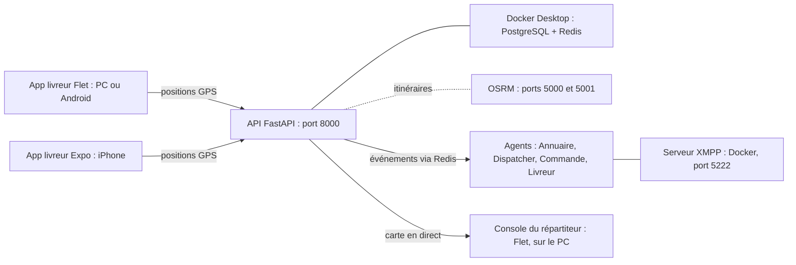

# Lancer tout le projet Livraison SMA

Guide de lancement, **à placer à la racine du dépôt** (`livraison-sma/LANCEMENT.md`, à côté de
`alembic.ini` et de `docker-compose.yml`). Il réunit toutes les commandes, dans l'ordre, avec le dossier
où les lancer et ce qu'on doit voir quand ça marche.

Les commandes sont pour **PowerShell sous Windows**. Le dossier du projet est supposé être
`D:\Cours-M2\SMA\livraison-sma` : adapte-le si le tien est ailleurs.

## Sommaire

1. [Vue d'ensemble](#1-vue-densemble)
2. [Installation, une seule fois](#2-installation-une-seule-fois)
3. [Lancement au quotidien](#3-lancement-au-quotidien)
4. [Parcours de démonstration, de bout en bout](#4-parcours-de-démonstration-de-bout-en-bout)
5. [Tests](#5-tests)
6. [Tout arrêter](#6-tout-arrêter)
7. [Dépannage](#7-dépannage)
8. [Ce qui n'existe pas encore](#8-ce-qui-nexiste-pas-encore)
9. [Où est quoi](#9-où-est-quoi)

## 1. Vue d'ensemble



| Brique | Rôle | Obligatoire pour | Port |
|---|---|---|---|
| Docker Desktop (PostgreSQL, Redis) | Base de données et temps réel | tout | 5432, 6379 |
| API FastAPI (`uvicorn`) | Le serveur : comptes, dossiers livreurs, positions | tout | 8000 |
| Console du répartiteur (Flet) | La carte avec les livreurs en direct | voir les positions | aucun |
| App livreur Expo (`npx expo start`) | L'app iOS, testée sur iPhone | tester le GPS sur iPhone | 8081 |
| App livreur Flet | Prototype du livreur sur PC (simulation) ou Android | tester sans iPhone | aucun |
| OSRM (Docker) | Calcul des itinéraires (F-42) : coût des offres des agents | l'attribution des courses | 5000, 5001 |
| Serveur XMPP (Docker, `docker-compose.xmpp.yml`) | Messagerie des agents | les agents | 5222 |
| Agents (`python -m livraison.agents`) | Annuaire, Dispatcher, un agent par livreur en ligne et par commande à attribuer (F-30 à F-34) | l'attribution des courses | aucun |

## 2. Installation, une seule fois

Chaque bloc indique le **dossier** où l'exécuter.

### 2.1 Logiciels à installer

| Logiciel | Version | Vérification |
|---|---|---|
| Python | **3.13** (pas 3.14, non validé) | `python --version` |
| Docker Desktop | récent, **démarré** | `docker --version` |
| Node.js | récent | `node --version` |
| Expo Go sur l'iPhone | celui de l'App Store (SDK 57 aujourd'hui) | version affichée dans l'app |

### 2.2 Environnement Python

Dossier : **racine du dépôt**.

```powershell
cd D:\Cours-M2\SMA\livraison-sma
python -m venv .venv
.venv\Scripts\Activate.ps1
```

Si PowerShell refuse d'exécuter le script (« l'exécution de scripts est désactivée ») :

```powershell
Set-ExecutionPolicy -Scope CurrentUser -ExecutionPolicy RemoteSigned
```

Puis, venv activé (le prompt commence par `(.venv)`) :

```powershell
pip install -r requirements.txt
pip install python-multipart httpx
```

`python-multipart` est indispensable à l'envoi de pièces justificatives (sans elle, le serveur ne démarre
pas) et `httpx` au service d'itinéraires. Si `requirements-dev.txt` existe, l'installer aussi :
`pip install -r requirements-dev.txt`. Si un `ModuleNotFoundError: livraison` apparaît plus tard :
`pip install -e .`.

**À chaque nouveau terminal**, réactiver le venv : `.venv\Scripts\Activate.ps1`.

### 2.3 Fichier `.env` (à la racine, non versionné)

Vérifie ces lignes (les autres ne changent pas) :

| Variable | Valeur | Pourquoi |
|---|---|---|
| `POSTGRES_HOST` | `127.0.0.1` | `localhost` ralentit sous Windows |
| `REDIS_URL` | `redis://127.0.0.1:6379/0` | même raison |
| `OSRM_URL` | `http://127.0.0.1:5000` | même raison |
| `OSRM_URL_VELO` | `http://127.0.0.1:5001` | serveur vélo |
| `XMPP_HOST` | `127.0.0.1` | `localhost` désigne `::1` avant `127.0.0.1` sous Windows |
| `XMPP_DOMAINE` | `127.0.0.1` | les agents se connectent à ce nom : le même que le serveur XMPP (§ 2.10) |
| `JWT_SECRET` | au moins **32 caractères aléatoires** | sinon le serveur refuse de signer |
| `ENVIRONNEMENT` | `dev` | le code SMS s'affiche dans la console |
| `SMS_MODE` | `console` | aucun vrai SMS envoyé |
| `LIVREUR_VALIDATION_REQUISE` | `false` | un livreur non validé peut passer en ligne (tests GPS) |

Les identifiants PostgreSQL doivent être les mêmes que dans `docker-compose.yml`.

Les réglages de l'attribution des courses (délai de confirmation, rayon, nombre de tours) ont des valeurs par
défaut et se changent aussi dans `.env` : voir `docs/contract-net.md`, § 6.

### 2.4 Pare-feu Windows (PowerShell **en administrateur**)

À faire une fois, pour que l'iPhone atteigne le PC :

```powershell
New-NetFirewallRule -DisplayName "Livraison API 8000" -Direction Inbound -Protocol TCP -LocalPort 8000 -Action Allow
New-NetFirewallRule -DisplayName "Expo Metro 8081" -Direction Inbound -Protocol TCP -LocalPort 8081 -Action Allow
```

### 2.5 Base de données

Dossier : **racine**, Docker Desktop démarré, venv activé.

```powershell
docker compose up -d
alembic upgrade head
alembic check
python scripts/verifier_env.py
```

- `alembic check` doit répondre « No new upgrade operations detected ».
- `alembic upgrade head` applique les migrations `0001` à `0003`.

Base des **tests**, séparée de la base de développement :

```powershell
python scripts/preparer_base_test.py
```

Tu dois lire : `Base de test prête : livraison_test, révision 0003, 18 tables.`

### 2.6 Comptes du personnel

Dossier : **racine**. Le numéro de chaque compte doit être **différent** de ceux des livreurs.

```powershell
python scripts/creer_personnel.py --telephone 0101010101 --role repartiteur --nom Demo
python scripts/creer_personnel.py --telephone 0102030405 --role administrateur --nom Admin
```

Le premier compte est le répartiteur, qui sert à la carte. Le second est l'administrateur, qui valide les
dossiers livreurs : si le script refuse `--role administrateur`, envoie-moi `scripts/creer_personnel.py`.
Les livreurs, eux, n'ont pas besoin de commande : leur compte est créé à la première connexion dans
l'application.

### 2.7 Application iPhone (Expo)

Dossier : `mobile\gps-ios`.

```powershell
cd D:\Cours-M2\SMA\livraison-sma\mobile\gps-ios
npm install
```

Si tu as déjà installé une version précédente, supprime d'abord `node_modules` et `package-lock.json`.

Trouve l'**adresse IPv4 Wi-Fi du PC** :

```powershell
ipconfig
```

Cherche la ligne « Adresse IPv4 » de la carte Wi-Fi (par exemple `192.168.1.12`). Mets-la dans
`mobile\gps-ios\src\config.ts` (`SERVEUR_PAR_DEFAUT`), ou saisis-la à l'écran de connexion de l'app. Elle
change parfois d'un jour à l'autre.

### 2.8 Application livreur Flet (facultative)

Dossier : `mobile\livreur`. Rien à installer de plus si le venv est prêt. Voir § 3, terminal 6.

### 2.9 Itinéraires OSRM (nécessaires pour attribuer les courses)

Dossier : **racine**, Docker Desktop démarré.

```powershell
python scripts/preparer_osrm.py
docker compose -f docker-compose.osrm.yml up -d
python scripts/verifier_osrm.py
```

La première commande télécharge la carte et prépare les données (plusieurs minutes). La dernière doit
afficher `voiture: répond`, `velo: répond`, puis un tableau de trajets `plausible`. Détails et dépannage :
`docs/itineraires.md`.

### 2.10 Serveur XMPP dans Docker (nécessaire pour les agents)

Dossier : **racine**, Docker Desktop démarré. Les fichiers `docker-compose.xmpp.yml` et `docker/xmpp/Dockerfile`
doivent exister (ils sont livrés avec le projet).

```powershell
docker compose -f docker-compose.xmpp.yml up -d --build
docker compose -f docker-compose.xmpp.yml logs --tail 5
```

La première construction dure 1 à 2 minutes. Les dernières lignes doivent contenir `Server started...`. On utilise
Docker et non `spade run` : sous Windows, le serveur de SPADE bloque une partie des connexions des agents. L'histoire
complète et le dépannage sont dans `docs/xmpp-depannage.md`.

## 3. Lancement au quotidien

Ouvre un **terminal PowerShell par ligne du tableau**, dans cet ordre. Dans chacun (sauf le terminal 5),
commence par :

```powershell
cd D:\Cours-M2\SMA\livraison-sma
.venv\Scripts\Activate.ps1
```

| N° | Dossier | Commande | Quand | Ce que tu dois voir |
|---|---|---|---|---|
| 0 | | **Démarrer Docker Desktop** | toujours | l'icône de la baleine, « Engine running » |
| 1 | racine | `docker compose up -d` | toujours | `Container ... Started` ou `Running` |
| 2 | racine | `uvicorn livraison.api.main:app --host 0.0.0.0 --reload --reload-dir src` | toujours | `Application startup complete.` |
| 3 | racine | `flet run src/livraison/interfaces/console_suivi.py` | pour voir la carte | la fenêtre « Suivi des livreurs » |
| 4 | `mobile\livreur` | `flet run src/main.py` | tester sans iPhone | la fenêtre « Livreur - prototype GPS » |
| 5 | `mobile\gps-ios` | `npx expo start` | tester sur iPhone | un QR code dans le terminal |
| 6 | racine | `docker compose -f docker-compose.osrm.yml up -d` | pour les itinéraires | `Container ... Started` |
| 7 | racine | `docker compose -f docker-compose.xmpp.yml up -d` | pour les agents | `Container livraison-xmpp  Started` |
| 8 | racine | `python -m livraison.agents` | après le terminal 7 | `Annuaire prêt`, `Dispatcher prêt`, puis `Agents démarrés` |
| 9 | racine | `python scripts/creer_commande_test.py --suivre` | pour essayer une attribution | `état=attribuee` quand un livreur a confirmé (§ 4) |

Précisions par terminal :

- **Terminal 2 (API).** Laisse-le ouvert : c'est ici que s'affichent le **code SMS** (ligne
  `[SMS SIMULÉ] Code de vérification pour ... : 123456`) et toutes les requêtes. Vérifie que le serveur répond :
  ouvre `http://127.0.0.1:8000/sante`, qui affiche `{"etat":"ok"}`, et `http://127.0.0.1:8000/docs`, la
  page Swagger de l'API.
- **Terminal 3 (carte).** Connecte-toi avec le compte répartiteur si la fenêtre te demande des identifiants
  (`0101010101` et son mot de passe). Dans le terminal 2, tu dois voir `POST /auth/connexion ... 200 OK` puis
  `WebSocket /ws/suivi ... [accepted]`.
- **Terminal 4 (Flet livreur).** Dans l'app, mets l'adresse `http://127.0.0.1:8000` si c'est sur le même
  PC. **Aucun espace** dans l'adresse (sinon `getaddrinfo failed`). Choisis le mode « Simulation » pour
  tester sans GPS.
- **Terminal 5 (Expo).** Sans venv. Scanne le QR code avec l'appareil photo de l'iPhone : Expo Go s'ouvre.
  Au premier lancement, iOS demande l'accès au **réseau local** : accepte. Si le QR code contient une
  mauvaise adresse (cartes réseau Docker ou WSL) :

  ```powershell
  $env:REACT_NATIVE_PACKAGER_HOSTNAME="192.168.1.12"; npx expo start
  ```

  (remplace par ton IPv4 Wi-Fi). Si le QR code ne marche pas : dans Expo Go, « Enter URL manually », puis
  `exp://192.168.1.12:8081`.
- **Terminal 7 (XMPP).** Une seule fois par session : le serveur tourne ensuite en arrière-plan dans Docker (pas de
  terminal à garder ouvert). `XMPP_DOMAINE` dans `.env` doit valoir `127.0.0.1`.
- **Terminal 8 (agents).** À lancer **après** le terminal 7 (sinon il refuse de démarrer, en le disant, au bout
  d'environ 10 s). Quand un livreur passe en ligne, tu dois lire `Agent créé pour le livreur ...` puis
  `Livreur ... inscrit (1 dans l'Annuaire)`. Détails : `docs/agents.md`.
- **Terminal 9 (commande de test).** Crée une commande « validée » et suit son attribution 90 s au plus. Les
  commandes viendront de l'API au lot 4 ; ce script joue leur rôle en attendant. Détails : `docs/contract-net.md`, § 2.

**Raccourci.** Pour une démonstration du suivi GPS, il suffit des terminaux **0, 1, 2, 3 et 5** (ou 4 à
la place de 5). Les terminaux 6, 7, 8 et 9 ne servent qu'à l'attribution des courses (itinéraires, agents, commande de test).

## 4. Parcours de démonstration, de bout en bout

Terminaux 1, 2, 3 et 5 lancés. L'iPhone et le PC sont sur le **même Wi-Fi**.

1. **Test réseau.** Sur l'iPhone, Safari : `http://192.168.1.12:8000/docs` (ton IP). La page Swagger doit
   s'afficher. La racine `http://192.168.1.12:8000/` répond `{"detail":"Not Found"}` : c'est normal.
2. **Connexion.** Dans l'app Expo, vérifie l'adresse du serveur et saisis le numéro de test
   `07 00 00 00 02` (un numéro de livreur **différent** de ceux du répartiteur et de l'app Flet). Touche
   **Demander le code**.
3. **Code SMS.** Dans le terminal 2, relève les 6 chiffres de la dernière ligne `[SMS SIMULÉ]`. Saisis-les
   dans l'app, touche **Valider**.
4. **En ligne.** Écran « Suivi GPS » : choisis **Simulation**, touche **Passer en ligne**.
5. **Carte.** Dans la fenêtre « Suivi des livreurs » du PC, un point **vert** apparaît et se déplace.
6. **GPS réel.** Dans l'app, **Passer hors ligne**, choisis **GPS de l'iPhone**, accepte la permission de
   localisation, **Passer en ligne**. Le point se place à ta position réelle (iPhone immobile : les « trous »
   de plus de 15 s sont normaux).

Lignes attendues dans le terminal 2, dans l'ordre :

```
POST /auth/code           202 Accepted     (+ la ligne [SMS SIMULÉ] juste avant)
POST /auth/verifier       200 OK
PUT  /livreurs/moi/profil 200 OK
POST /livreurs/moi/en-ligne 200 OK
POST /livreurs/moi/position 200 OK         (une toutes les 5 s environ, en boucle)
```

### Valider un dossier livreur (administrateur)

Dossier livreur et décisions de l'administrateur, étape par étape dans Swagger
(`http://127.0.0.1:8000/docs`) : voir `docs/dossier-livreur.md`, § 7.

### Attribuer une commande à un livreur (Contract Net)

Terminaux 0, 1, 2, 6, 7 et 8 lancés, avec l'app livreur (terminal 4 ou 5).

1. **Dossier validé.** Le livreur de test doit avoir un dossier **validé** par l'administrateur
   (`docs/dossier-livreur.md`, § 7), sinon le Dispatcher ne le consulte pas.
2. **En ligne, avec une position récente.** Dans l'app : **Passer en ligne** (mode Simulation possible).
3. **La commande.** Terminal 9 : `python scripts/creer_commande_test.py --suivre`. Elle est au Plateau et le premier
   tour cherche à 3 km ; si ton livreur simulé est ailleurs, ajoute `--enlevement <latitude>,<longitude>` avec un
   point proche de lui.
4. **La course est proposée.** Le livreur la voit avec `GET /livreurs/moi/proposition` (Swagger,
   `http://127.0.0.1:8000/docs`, bouton **Authorize** avec le jeton du livreur) et a **30 secondes** pour répondre :
   `POST /livreurs/moi/proposition/<commande>/confirmer` (ou `/decliner`).
5. **Résultat.** Le terminal 9 affiche `état=attribuee`. S'il décline ou laisse passer les 30 s, un nouveau tour part
   sans lui ; sans livreur, le rayon s'élargit (3, 6, 12, 20 km) puis une alerte est écrite pour le répartiteur.

Fonctionnement, réglages et limites : `docs/contract-net.md`. L'écran de proposition dans l'app mobile n'existe pas
encore (lot 3) : on passe par Swagger.

## 5. Tests

Dossier : **racine**, venv activé, Docker démarré.

```powershell
pytest                                       # tous les tests (base livraison_test)
pytest --ignore tests/test_agents_xmpp.py --ignore tests/test_contract_net_xmpp.py   # sans le serveur XMPP
pytest tests/test_dossier_livreur.py         # le dossier livreur
pytest tests/test_itineraires.py             # les itinéraires (un test attend OSRM, ignoré sinon)
```

Résultat attendu : tout en « passed », éventuellement un « skipped » pour le test qui interroge le vrai OSRM.
**464 tests** avec le serveur XMPP démarré (§ 2.10) ; sans lui, les 16 tests d'agents réels
(`test_agents_xmpp.py`, `test_contract_net_xmpp.py`) sont **ignorés**, pas en échec.

- Des tests « skipped » avec le message *Base de test non prête* : `python scripts/preparer_base_test.py`.
- **Après chaque nouvelle migration** : `alembic upgrade head` (base de développement) **puis**
  `python scripts/preparer_base_test.py` (base de test).
- Un test XMPP en échec sur la connexion : `docs/xmpp-depannage.md`.
- Détails : `docs/tests.md`.

## 6. Tout arrêter

| Quoi | Comment |
|---|---|
| API, console, Flet, Expo, agents | `Ctrl + C` dans leur terminal |
| Serveur XMPP | `docker compose -f docker-compose.xmpp.yml down` |
| PostgreSQL et Redis | `docker compose down` (les **données sont conservées**) |
| OSRM | `docker compose -f docker-compose.osrm.yml down` |

**Ne jamais** ajouter `-v` à `docker compose down` : cela **supprime la base de données**.

Pour repartir d'une base de développement vide (supprime tout, comptes compris) :

```powershell
docker compose down -v
docker compose up -d
alembic upgrade head
```

Il faut ensuite recréer les comptes du § 2.6.

## 7. Dépannage

| Ce que tu vois | Cause | Action |
|---|---|---|
| `ConnectionRefusedError` vers PostgreSQL | Docker Desktop éteint ou conteneurs arrêtés | Démarrer Docker Desktop, puis `docker compose up -d` |
| Le serveur refuse de démarrer, `JWT_SECRET` | secret trop court | Mettre 32 caractères aléatoires ou plus dans `.env` |
| Le serveur plante au démarrage, `python-multipart` | dépendance absente | `pip install python-multipart` |
| `ModuleNotFoundError: livraison` | le projet n'est pas installé dans le venv | `pip install -e .` (venv activé) |
| Requêtes qui durent environ 2 s | `localhost` dans `.env` | Utiliser `127.0.0.1` partout (§ 2.3) |
| Pas de ligne `[SMS SIMULÉ]` malgré `202 Accepted` | plus de 3 codes demandés en 10 minutes, ou numéro d'un autre rôle | Attendre 10 minutes, ou prendre un autre numéro livreur |
| `403 Droits insuffisants` dans l'app | le numéro appartient à un répartiteur ou administrateur | Utiliser un numéro livreur |
| `getaddrinfo failed` dans une app | espace dans l'adresse du serveur | Format exact : `http://192.168.1.12:8000` |
| L'iPhone n'atteint pas le serveur | pas le même Wi-Fi, IP changée, pare-feu | `ipconfig`, règles du § 2.4, test Safari `/docs` |
| Expo Go : « incompatible with this version of Expo Go » | le SDK du projet n'est pas celui d'Expo Go | Aligner le projet sur la version indiquée dans le message |
| Les positions sont « refusées » (erreur 422) | horloges du PC et de l'iPhone désynchronisées | Régler l'heure en automatique des deux côtés |
| Point rouge « PÉRIMÉE » sur la carte | plus de position depuis plus de 30 s | Rester dans l'app, écran allumé (suivi au premier plan seulement) |
| Les agents ne communiquent pas | le serveur XMPP et `XMPP_DOMAINE` n'ont pas la même adresse | `127.0.0.1` des deux côtés (§ 2.3, § 2.10) |
| `Connexion XMPP impossible ...` au lancement des agents | le serveur XMPP est éteint | `docker compose -f docker-compose.xmpp.yml up -d` (terminal 7) |
| Les 16 tests d'agents réels sont « skipped » | le serveur XMPP est éteint | Le démarrer (§ 2.10) puis relancer `pytest` |
| Les 16 tests d'agents réels échouent (`un agent n'arrive pas à s'y connecter`) | un `spade run` lancé à la main sous Windows bloque | Arrêter `spade run`, utiliser le serveur Docker : `docs/xmpp-depannage.md` |
| `docker compose -f docker-compose.xmpp.yml` : « file not found » | les fichiers du serveur XMPP ne sont pas à la racine | Voir `docs/xmpp-depannage.md`, § 2, ligne 6 |
| Le conteneur XMPP redémarre en boucle | erreur au démarrage du serveur | `docker compose -f docker-compose.xmpp.yml logs --tail 30` ; après correction : `up -d --build` |
| Les agents tournent mais la commande de test n'est jamais attribuée | aucun livreur **en ligne, validé, avec une position récente** dans le rayon | `Aucun livreur éligible` dans le terminal 8 : voir § 4, étapes 1 à 3 |
| `GET /livreurs/moi/proposition` répond `null` | pas de course proposée, ou les 30 s sont passées | Relancer la commande de test |
| Rien dans le terminal des agents quand un livreur passe en ligne | Redis arrêté, ou agents non lancés | `docker compose up -d`, puis `python -m livraison.agents` |
| Des fichiers `server.db` apparaissent à la racine | créés par un `spade run` lancé à la main | Normal : les ignorer dans `.gitignore` |
| Les messages d'un programme lancé à la main s'affichent en rouge dans PowerShell | ils sortent sur la sortie d'erreur | Normal : ce sont des messages d'information |
| Deux fichiers `main.py` | normal | `src/livraison/api/main.py` est le serveur, `mobile/livreur/src/main.py` est l'app Flet |
| `docker compose` signale des « orphan containers » | deux fichiers compose dans le même dossier | Ignorer le message, ne pas ajouter `--remove-orphans` |

Pour un problème que ce tableau ne couvre pas : copie les **dernières lignes du terminal concerné** (et, pour
une app, celles de son journal).

## 8. Ce qui n'existe pas encore

Pour ne pas chercher ce qui n'est pas là :

- **Les commandes elles-mêmes** (création, validation, paiement par l'API) : lots 4 et 5. En attendant,
  `scripts/creer_commande_test.py` crée une commande « validée » et lance l'attribution.
- **Le suivi d'une course après son attribution** (enlèvement, livraison, clôture) et l'**écran de proposition** dans
  l'app livreur : lot 3. Les routes existent (`/livreurs/moi/proposition`), on les utilise via Swagger.
- **La priorité urgente, le détour dans le coût des offres, la reprise après panne** : lot 7. La **réattribution
  manuelle** par le répartiteur : lot 6 (l'alerte est déjà écrite).
- **Les interfaces React** (espace client, console du répartiteur, administration) : prévues aux lots 4 et 6.
  La carte actuelle est la console Flet provisoire. Les écrans prévus sont dans `docs/conception/`.
- **L'écran du dossier livreur** dans l'app mobile : le serveur est prêt (routes `/livreurs/moi/dossier` et
  `/admin/...`), on l'utilise via Swagger.
- **Le suivi écran verrouillé sur iPhone** : l'app iOS suit la position **application ouverte** seulement.

## 9. Où est quoi

```
livraison-sma/
├── LANCEMENT.md                 ce fichier
├── alembic.ini, docker-compose.yml, docker-compose.osrm.yml, docker-compose.xmpp.yml, pyproject.toml,
│   .env (non versionné)
├── docker/xmpp/Dockerfile       image du serveur XMPP (SPADE sous Linux)
├── docs/                        modele-donnees.md, dossier-livreur.md, tests.md, itineraires.md, agents.md,
│                                contract-net.md, xmpp-depannage.md, conception/
├── migrations/versions/         0001, 0002, 0003
├── scripts/                     verifier_env.py, creer_personnel.py, preparer_base_test.py,
│                                preparer_osrm.py, verifier_osrm.py, analyser_positions.py,
│                                creer_commande_test.py, diagnostic_xmpp.py,
│                                reinitialiser_mot_de_passe.py
├── src/livraison/               config.py, api/, services/, persistance/, agents/, interfaces/
├── tests/                       tous les tests
├── data/                        cartes OSRM (hors Git)
├── stockage/                    pièces justificatives des livreurs (hors Git)
└── mobile/
    ├── livreur/                 app Flet (PC ou Android)
    └── gps-ios/                 app Expo (iPhone)
```

Vérifie que `.gitignore` contient bien : `.env`, `.venv/`, `data/`, `stockage/`, `node_modules/` et
`server.db*` (créés par un `spade run` lancé à la main), `xmpp_sonde.log`, `diagnostic_xmpp.log` et
`serveur_xmpp.log` (journaux locaux du diagnostic XMPP).

Documentation détaillée : `docs/tests.md` (base de test), `docs/dossier-livreur.md` (dossier livreur),
`docs/itineraires.md` (OSRM), `docs/agents.md` (agents), `docs/contract-net.md` (attribution des courses),
`docs/xmpp-depannage.md` (serveur XMPP), `docs/conception/README.md` (dossier de conception),
`mobile/gps-ios/README.md` (app iPhone).
