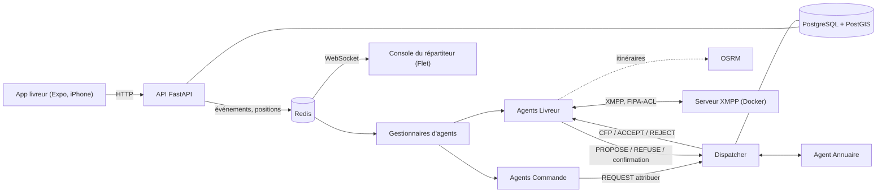

# Récap : projet Livraison SMA (au 10 novembre 2026)

Récapitulatif complet du projet, pour **reprendre dans une nouvelle discussion**. Le cahier des charges de référence est la version 2.0
fournie avec le projet.

## Sommaire

1. [Le projet](#1-le-projet)
2. [Décisions prises](#2-décisions-prises)
3. [État d'avancement](#3-état-davancement)
4. [Ce qui a été fait depuis le récap du 26 octobre](#4-ce-qui-a-été-fait-depuis-le-récap-du-26-octobre)
5. [Arborescence du dépôt](#5-arborescence-du-dépôt)
6. [Lancer le projet](#6-lancer-le-projet)
7. [Pièges rencontrés](#7-pièges-rencontrés)
8. [Vérifié et non vérifié](#8-vérifié-et-non-vérifié)
9. [À faire maintenant](#9-à-faire-maintenant)
10. [Pour reprendre dans une nouvelle discussion](#10-pour-reprendre-dans-une-nouvelle-discussion)

## 1. Le projet

Plateforme de livraison urbaine à **Abidjan**, avec attribution des courses par **appel d'offres
(Contract Net)** entre agents. Projet du module Systèmes multi-agents (Master 2, BD & GL). Travail en solo
pour l'instant. Le cahier de référence est la **version 2.0**
(`Cahier_des_charges_Livraison_SMA_v2.docx`), qui découpe le travail en lots.

| Brique | Technologie |
|---|---|
| Serveur et agents | Python 3.13, FastAPI, SPADE 4.1.4 (XMPP), PostgreSQL 16 + PostGIS, Redis |
| Serveur XMPP | Celui de SPADE (pyjabber 0.4.5), **dans Docker (Linux)** : sous Windows, `spade run` bloque une partie des connexions |
| Itinéraires | OSRM auto-hébergé (v5.27.1), deux serveurs : voiture (aussi pour la moto) et vélo |
| App livreur | React Native / **Expo SDK 58** (iPhone, Expo Go) ; Flet pour PC et Android |
| Interfaces web (plus tard) | React : espace client, console du répartiteur, administration |
| Dépôt | Un seul dépôt GitHub privé |



## 2. Décisions prises

| N° | Décision | Statut |
|---|---|---|
| D-01 | SPADE et XMPP pour les agents (comme le TP JADE) | actée |
| D-02 | Les agents tournent dans un **processus séparé** de l'API (`python -m livraison.agents`) | proposée, **implémentée**, **à confirmer** |
| D-03 | Redis transporte les événements entre l'API et les agents | proposée, **implémentée**, **à confirmer** |
| D-04 | PostgreSQL est la seule source de vérité ; Redis ne sert qu'au temps réel ; la réconciliation rattrape les événements perdus | proposée, **implémentée**, **à confirmer** |
| D-05 | OSRM auto-hébergé pour les itinéraires ; la **moto utilise le profil voiture** | actée (cahier F-42) |
| D-06 | Seul le **Dispatcher** envoie les `ACCEPT-PROPOSAL` (garantit la non double attribution) | proposée, **implémentée**, **à confirmer** |
| D-07 | La confirmation du livreur (30 s) est suivie par **son agent** ; l'API ne parle pas aux agents, elle publie des événements | proposée, implémentée |
| D-08 | La **charge d'un livreur est contrôlée en base** avant chaque attribution (la base a le dernier mot) | proposée, implémentée |
| D-09 | Le coût d'une offre n'inclut **pas de détour** avant le lot 7 (durée jusqu'à l'enlèvement + 300 s par course portée) | proposée, implémentée |
| D-10 | Relances : le rayon grandit après un tour sans livreur retenu, pas après un refus humain ; 6 tours puis alerte du répartiteur | proposée, implémentée |
| D-11 | Le serveur XMPP tourne dans **Docker (Linux)**, pas avec `spade run` sous Windows | adoptée (voir `docs/xmpp-depannage.md`) |

Détail : `docs/conception/06-decisions.md` (D-01 à D-10). **Je n'ai jamais reçu de réponse explicite sur D-02,
D-03, D-04, D-06 : elles sont implémentées telles que proposées, à valider (D-07 à D-10 aussi).**

Autres choix :
- **Expo SDK 58** : le projet mobile iOS et ses dépendances sont alignés sur le SDK requis par ton Expo Go.
- **Tests sur une base séparée** (`livraison_test`), jamais sur la base de développement.
- **`LIVREUR_VALIDATION_REQUISE=false`** en développement : les livreurs en attente peuvent tester les courses ;
  les profils suspendus ou rejetés restent exclus. En production, la validation est obligatoire.
- **127.0.0.1 partout** (PostgreSQL, Redis, OSRM, XMPP) : sous Windows, `localhost` désigne `::1` avant `127.0.0.1`.
- **Appli iPhone au premier plan seulement** : le suivi écran verrouillé demande un development build (hors lot 1).
- **Valeurs de l'attribution à calibrer** avec des essais réels (`docs/contract-net.md`, § 6) : collecte 3 s, confirmation 30 s,
  rayon 3 km puis x2 jusqu'à 20 km, 6 tours, pénalité 300 s par course portée, 3 courses simultanées au maximum.

## 3. État d'avancement

### Lot 1 : conception et socle, **terminé**

| Élément | État |
|---|---|
| Environnement, modèle de données (14 tables), authentification par SMS simulé, JWT, 4 rôles | fait |
| Suivi GPS : serveur, app Flet, **app Expo testée sur iPhone**, carte du répartiteur | fait, validé |
| Dossier livreur F-03 : pièces justificatives, validation par l'administrateur, migration `0003` | fait |
| Base de données dédiée aux tests | fait |
| Dossier de conception : cas d'utilisation, états, séquences, 9 maquettes, décisions, budget | fait (`docs/conception/`) |

### Lot 2 : cœur multi-agents, **fonctionnel et testé**

| Exigence | État |
|---|---|
| F-42 itinéraires OSRM | fait |
| F-30 agent Livreur créé à la connexion, inscrit à l'Annuaire | fait |
| F-31 Contract Net : Dispatcher, agent Commande, CFP, PROPOSE, ACCEPT, coût sur l'itinéraire réel | **fait**, validé chez toi (16 tests d'agents réels) |
| F-34 confirmation du livreur en 30 s, réattribution | **fait** (routes `/livreurs/moi/proposition...`) |
| F-32 concurrence et capacité | **fait** (garde-fou de charge en base, scénario de deux commandes pour un livreur) |
| F-33 file d'attente et relance, rayon élargi, alerte du répartiteur | **fait** (la réattribution manuelle est au lot 6) |
| F-63 journal des messages entre agents (table `evenement`, type `message_agent`) | **fait** pour le Contract Net |
| F-35 priorité urgente (importante selon le cahier v2) | **fait** : urgentes d'abord dans la file et dans les décisions concurrentes du Dispatcher |
| F-36 reprise après redémarrage (importante selon le cahier v2) | **implémentée** : gestionnaires reconstruits depuis la base, charge du livreur restaurée depuis les commandes/offres en cours ; les courses actives sont relues depuis la base |
| Essai complet à la main (livreur en ligne, commande de test, confirmation) | **à faire sur ton environnement** (`LANCEMENT.md`, § 4) |

F-36 est à valider par un redémarrage réel des services et une course en cours. Les calculs de détour et le
regroupement ne sont pas inclus dans ce lot.

### Lots suivants (cahier § 8.2)

| Lot | Contenu |
|---|---|
| 3 | Application livreur : propositions, guidage, remise avec code et incidents ; parcours d'incident ajoutés dans les apps, validation terrain restante |
| 4 | Espace client web (React) : commande, suivi |
| 5 | Paiement et facturation |
| 6 | Console du répartiteur et administration (React) : la console Flet actuelle est provisoire ; réattribution manuelle |
| 7 | Optimisation, regroupement, reprise après panne |
| 8 | Pilote terrain |

## 4. Ce qui a été fait depuis le récap du 26 octobre

1. **Contract Net** : agent Commande, Dispatcher, réponse des agents Livreur (offres et refus motivés : `hors_ligne`,
   `vehicule`, `trop_lourd`, `sature`, `gps_ancien`, `hors_zone`, `itineraire`), coût sur l'itinéraire réel, offres et
   messages écrits en base, confirmation en 30 s (3 routes API), réattribution, relances avec rayon élargi.
   Guide : `docs/contract-net.md`.
2. **Gestionnaires** : le gestionnaire des livreurs transmet `commande_validee` au gestionnaire des commandes et les
   réponses des livreurs à leurs agents ; les agents Commande sont créés à l'événement puis par réconciliation.
3. **Priorité et reprise** : F-35 ordonne la file et les décisions concurrentes. F-36 restaure la charge du livreur depuis la
   base lors de la recréation de son agent ; la course active est déjà une donnée persistée accessible par l'API.
4. **Applications livreur** : Expo SDK 58 et Flet proposent maintenant les actions de base du lot 3 : proposition
   (acceptation, refus, priorité), course active, itinéraire, appel, enlèvement, code de livraison et signalement des
   quatre incidents F-24. Le serveur enregistre le motif en événement et termine la tentative en `echec_livraison`.
   Les essais complets sur appareils et en conditions terrain restent à faire.
5. **Tests** : 187 nouveaux tests du Contract Net (dont 7 avec de vrais agents XMPP), 11 pour le script de mot de passe.
   **14 défauts volontaires** introduits dans le code : tous détectés.
6. **Serveur XMPP** : plusieurs jours de diagnostic (`localhost` en IPv6, tests de plus de 40 minutes, serveur Windows bloqué
   après le passage en TLS), réglés en lançant le serveur dans Docker (`docker-compose.xmpp.yml`). Détail et chronologie :
   `docs/xmpp-depannage.md`. Outil : `scripts/diagnostic_xmpp.py`.
7. **Scripts** : `scripts/creer_commande_test.py` (commande de test + suivi de l'attribution),
   `scripts/reinitialiser_mot_de_passe.py` (mot de passe d'un répartiteur ou administrateur oublié).
8. **Documentation** : `LANCEMENT.md`, `docs/agents.md`, `docs/contract-net.md`, `docs/xmpp-depannage.md`, ce récap.

Avant cela (récap du 26 octobre) : suivi GPS validé sur iPhone, dossier livreur F-03, base de test, dossier de conception,
service OSRM, Annuaire, agent Livreur et gestionnaire.

## 5. Arborescence du dépôt

```
livraison-sma/
├── LANCEMENT.md, RECAP_Livraison_SMA.md
├── alembic.ini, pyproject.toml, requirements*.txt, .env (non versionné)
├── docker-compose.yml                PostgreSQL + Redis
├── docker-compose.osrm.yml           OSRM (voiture, vélo)
├── docker-compose.xmpp.yml           serveur XMPP (SPADE sous Linux)
├── docker/xmpp/Dockerfile            image du serveur XMPP (spade 4.1.4, pyjabber 0.4.5, greenlet)
├── docs/
│   ├── modele-donnees.md, dossier-livreur.md, tests.md, itineraires.md, agents.md,
│   │   contract-net.md, xmpp-depannage.md
│   └── conception/                   README, 01 à 06, maquettes/ (9 SVG)
├── migrations/versions/              0001, 0002, 0003_dossier_livreur
├── scripts/                          verifier_env, creer_personnel, reinitialiser_mot_de_passe,
│                                     analyser_positions, preparer_base_test, preparer_osrm, verifier_osrm,
│                                     creer_commande_test, diagnostic_xmpp
├── src/livraison/
│   ├── config.py
│   ├── agents/                       protocole, registre, annuaire, livreur, dispatcher, commande,
│   │                                 gestionnaire, gestionnaire_commandes, __main__, ping_pong
│   ├── api/                          main, routes_auth/livreur/suivi/dossier/admin, schemas_* (dont schemas_courses),
│   │                                 dependances
│   ├── modele/                       cout.py (grille du TP + coût sur itinéraire), attribution.py (règles pures),
│   │                                 telephone.py
│   ├── persistance/                  modeles, enums, base, session
│   ├── services/                     auth, securite, sms, livreurs, positions, redis_client, dossier,
│   │                                 itineraires, evenements, erreurs, attribution, courses
│   └── interfaces/                   console_suivi.py (carte du répartiteur, Flet)
├── tests/                            conftest, aides, aides_commandes, aides_xmpp, test_*
├── mobile/
│   ├── livreur/                      app Flet (PC, Android) : attention, son main.py n'est pas celui du serveur
│   └── gps-ios/                      app Expo (iPhone) : App.tsx, src/, README
├── data/                             cartes OSRM (hors Git)
└── stockage/                         pièces justificatives (hors Git)
```

Deux fichiers `main.py` : `src/livraison/api/main.py` (le serveur) et `mobile/livreur/src/main.py` (l'app Flet).

## 6. Lancer le projet

Tout est dans **`LANCEMENT.md`**. Résumé, un terminal par ligne, venv activé :

```powershell
docker compose up -d                                                      # PostgreSQL + Redis
uvicorn livraison.api.main:app --host 0.0.0.0 --reload --reload-dir src   # API
flet run src/livraison/interfaces/console_suivi.py                        # carte du répartiteur
cd mobile\gps-ios; npx expo start                                         # app iPhone
docker compose -f docker-compose.osrm.yml up -d                           # OSRM
docker compose -f docker-compose.xmpp.yml up -d                           # serveur XMPP
python -m livraison.agents                                                # agents
python scripts/creer_commande_test.py --suivre                            # essayer une attribution
pytest                                                                    # tests (464, serveur XMPP démarré)
```

## 7. Pièges rencontrés

| Piège | Solution |
|---|---|
| `localhost` dans `.env` | Utiliser `127.0.0.1` (PostgreSQL, Redis, OSRM, **XMPP**) : sinon environ 2 s par requête, et sous Windows `localhost` désigne `::1` avant `127.0.0.1` |
| `spade run` sous Windows | Le serveur bloque une partie des connexions des agents (reste bloqué après le passage en TLS) : utiliser le serveur Docker |
| Les 16 tests d'agents réels ignorés | Normal sans serveur XMPP ; le démarrer pour les exécuter |
| `docker-compose.xmpp.yml` « file not found » | Les fichiers ne sont pas copiés à la racine : voir `docs/xmpp-depannage.md` |
| Build Docker : `No matching distribution found for aiohttp` | Réseau du conteneur : le Dockerfile a des délais longs et des nouvelles tentatives ; relancer |
| Conteneur XMPP qui plante : `greenlet` | SQLAlchemy 2.1 ne l'installe plus : il est dans le Dockerfile |
| `spade run --memory` | Cassé avec ces versions (`no such table: credentials`) : ne pas l'utiliser |
| Rouge dans PowerShell pour un programme lancé à la main | Normal : les messages d'information sortent sur la sortie d'erreur |
| `spade run` lancé à la main crée `server.db*` | Les ignorer dans `.gitignore` |
| Python 3.14 | À éviter : le projet est validé en 3.13 |
| `JWT_SECRET` trop court | Au moins 32 caractères aléatoires |
| `python-multipart` absent | Le serveur ne démarre plus : `pip install python-multipart` |
| Expo Go : « incompatible with this version » | Aligner le SDK du projet sur celui d'Expo Go (57 aujourd'hui) |
| Pas de ligne `[SMS SIMULÉ]` | Plus de 3 codes en 10 minutes, ou numéro d'un autre rôle |
| `403` dans l'app livreur | Le numéro appartient à un répartiteur ou à un administrateur |
| Mot de passe répartiteur oublié, ou compte verrouillé | `python scripts/reinitialiser_mot_de_passe.py --telephone 0101010101` |
| Positions « refusées » (422) | Horloges du PC et de l'iPhone désynchronisées |
| Pare-feu Windows | Ouvrir les ports 8000 (API) et 8081 (Expo) en PowerShell administrateur |
| Tests en conflit avec la base de développement | Base de test séparée : `python scripts/preparer_base_test.py` |
| Commande de test jamais attribuée | Aucun livreur **en ligne, validé, avec une position récente** dans le rayon |
| `DROP` accidentel de la base | Ne jamais faire `docker compose down -v` |
| `ConnectionRefusedError` vers PostgreSQL | Docker Desktop éteint ou conteneurs arrêtés |

## 8. Vérifié et non vérifié

**Vérifié dans le dépôt courant** :
- dernière suite complète effectuée avant les modifications présentes : **278 passés, 211 ignorés** sans le serveur XMPP ;
- les tests ciblés F-35/F-36 et des clients doivent être relancés après cette mise à jour.

**Non vérifié** :
- un **essai complet à la main** : livreur réel en ligne, `creer_commande_test.py`, confirmation par Swagger ;
- un parcours de course réel Expo/Flet de bout en bout, notamment après redémarrage des services ;
- ton `services/dossier.py` réel : j'ai utilisé la signature vue dans tes tests (tes tests de dossier passent) ;
- `scripts/creer_personnel.py --role administrateur`, jamais relu ;
- les prix du budget (le poste dominant est le **SMS**, 0,25 à 0,50 USD le code) et la console Flet (`console_suivi.py`) ;
- la **cause exacte** du blocage du serveur XMPP sous Windows (non creusée : le contournement Docker suffit).

## 9. À faire maintenant

### Avant de pousser sur GitHub

1. Copier les fichiers de la dernière livraison (chemin et action de chacun : `docs/contract-net.md`, § 1).
2. Vérifier que `.gitignore` contient : `.env`, `.venv/`, `data/`, `stockage/`, `node_modules/`, `__pycache__/`, `server.db*`,
   `xmpp_sonde.log`, `diagnostic_xmpp.log`, `serveur_xmpp.log`.
3. Relancer les tests ciblés puis `pytest` en entier avec le serveur XMPP démarré ; noter les résultats et les tests ignorés.
4. `git status` : ne jamais commiter `.env`, `server.db*`, les journaux, `data/` ni `stockage/`.

### Étape suivante possible (à choisir)

- **Valider le lot 2 sur ton environnement** : redémarrage pendant une course, essai complet à la main et calibrage
  des réglages (`docs/contract-net.md`, §§ 6 et 11).
- **Valider le lot 3** : essayer les quatre motifs d'incident et le parcours complet sur appareils iOS/Android ;
  le comportement de la tentative après incident est documenté dans `docs/conception/04-maquettes.md`.

### Questions à trancher

- Valides-tu D-02, D-03, D-04, D-06, et D-07 à D-10 ? Passe leur statut à « actée » dans `docs/conception/06-decisions.md`.
- Quelles valeurs pour le délai de collecte, le rayon initial, la pénalité de charge et la charge maximale, après essais ?
- Un **compte administrateur** est-il créé pour valider les dossiers des livreurs de test (`creer_personnel.py --role administrateur`) ?

## 10. Pour reprendre dans une nouvelle discussion

### Fichiers à joindre

**Ne jamais joindre** : `.env`, `.venv/`, `node_modules/`, `data/`, `stockage/`, `server.db*`, les journaux (`*.log`), les secrets.

**1. Indispensables**

| Fichier | Pourquoi |
|---|---|
| `RECAP_Livraison_SMA.md` (ce fichier) et `LANCEMENT.md` | contexte et commandes |
| `Cahier_des_charges_Livraison_SMA_v2.docx` | référence des exigences |
| `docs/contract-net.md`, `docs/agents.md`, `docs/xmpp-depannage.md` | ce qui est construit et comment le lancer |
| `docs/conception/06-decisions.md`, `02-diagrammes-etats.md`, `03-sequences-protocole.md` | décisions, états et protocole |
| `src/livraison/agents/` : tous les fichiers (`protocole.py`, `registre.py`, `annuaire.py`, `livreur.py`, `dispatcher.py`, `commande.py`, `gestionnaire.py`, `gestionnaire_commandes.py`, `__main__.py`, `ping_pong.py`, `__init__.py`) | le code des agents |
| `src/livraison/modele/` : `cout.py`, `attribution.py`, `telephone.py` | règles pures |
| `src/livraison/services/` : tous les fichiers (dont `attribution.py`, `courses.py`, `evenements.py`, `itineraires.py`, `dossier.py`) | services |
| `src/livraison/persistance/` : `modeles.py`, `enums.py`, `base.py`, `session.py` | tables et énumérations |
| `src/livraison/config.py`, `docker-compose.yml`, `docker-compose.osrm.yml`, `docker-compose.xmpp.yml`, `docker/xmpp/Dockerfile`, `pyproject.toml`, `requirements*.txt`, `.env.example` | configuration, Docker, dépendances |
| `tests/conftest.py`, `tests/aides.py`, `tests/aides_commandes.py`, `tests/aides_xmpp.py` | fixtures des tests |

**2. Utiles** (si on touche à l'API, à l'app ou aux migrations)

| Fichier | Pourquoi |
|---|---|
| `src/livraison/api/` : `main.py`, `dependances.py`, `routes_livreur.py`, `schemas_gps.py`, `schemas_courses.py` | brancher l'écran de proposition de course |
| `src/livraison/services/auth.py`, `securite.py`, `sms.py` | rôles et tests d'API |
| `migrations/env.py`, `migrations/versions/0001_schema_initial.py` | nouvelle migration |
| `tests/test_positions_api.py`, `tests/test_courses.py` | style des tests d'API |
| `scripts/creer_personnel.py`, `scripts/creer_commande_test.py` | comptes et commande de test |

**3. Seulement si on y touche**

| Sujet | Fichiers |
|---|---|
| Console du répartiteur | `src/livraison/interfaces/console_suivi.py` |
| App Flet | `mobile/livreur/src/main.py`, `client_api.py`, `emetteur.py` |
| App iPhone | `mobile/gps-ios/App.tsx`, `src/` |

**4. Résultats à copier-coller**

- La fin de `pytest` en entier (le résumé « passed, failed, skipped »), avec le serveur XMPP démarré.
- Le terminal des agents (`python -m livraison.agents`) pendant un essai d'attribution.
- `python --version` et `pip list | findstr /i "spade redis fastapi sqlalchemy httpx pytest"`.
- Toute erreur rencontrée en appliquant les fichiers.

Si le nombre de fichiers est trop grand, un **zip du dépôt** convient (sans les éléments interdits ci-dessus), avec en plus ce récap.

### Message à coller pour commencer

> Je continue mon projet Livraison SMA (récap joint, cahier des charges v2). Le cœur du lot 2 est implémenté :
> Contract Net, priorité urgente et reconstruction des agents/charges depuis la base. Résultat de `pytest` chez moi :
> [colle le résumé]. Prochaine étape : valider F-36 par redémarrage pendant une course puis terminer le lot 3.
> Je valide / je
> modifie les décisions D-02, D-03, D-04, D-06 et D-07 à D-10 comme suit : [ta réponse]. Fichiers joints : [liste].
> Suis le même processus que d'habitude : chemin complet de chaque fichier et action (NOUVEAU ou REMPLACE) dans
> le guide, tests vérifiés avant de livrer.

### Habitudes de travail à garder

- Réponses directes, livrables complets et prêts à l'emploi, **un fichier par fichier** plutôt qu'une archive (un ZIP qui garde
  les chemins est acceptable quand il y a beaucoup de fichiers).
- Pour chaque livraison : **chemin complet de chaque fichier** et action (NOUVEAU ou REMPLACE) dans le guide.
- Dire clairement ce qui est **vérifié** et ce qui **ne l'est pas**.
- Commandes pour **PowerShell sous Windows**, avec le dossier où les lancer.
