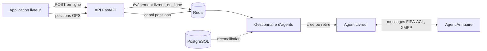

# Agents : Annuaire et agent Livreur (lot 2, F-30)

Quand un livreur passe en ligne, un **agent Livreur** est créé et s'inscrit à l'**Annuaire** ; quand il
repart hors ligne, l'agent disparaît. C'est la première brique du cœur multi-agents. Le Dispatcher, l'agent
Commande et le Contract Net (appel d'offres) s'appuient dessus : ils sont décrits dans
`docs/contract-net.md`.

Tous les chemins partent de la **racine du dépôt**, le dossier `livraison-sma/`.

## 1. Fichiers livrés et où les placer

Légende : **NOUVEAU** = le fichier n'existe pas chez toi ; **REMPLACE** = il existe, on écrase l'ancien.

```
livraison-sma/
├── LANCEMENT.md                                   REMPLACE
├── docs/
│   └── agents.md                                  NOUVEAU (ce fichier)
├── src/
│   └── livraison/
│       ├── config.py                              REMPLACE
│       ├── agents/
│       │   ├── __init__.py                        (inchangé, ne pas toucher)
│       │   ├── ping_pong.py                       (inchangé, ne pas toucher)
│       │   ├── __main__.py                        NOUVEAU
│       │   ├── annuaire.py                        NOUVEAU
│       │   ├── gestionnaire.py                    NOUVEAU
│       │   ├── livreur.py                         NOUVEAU
│       │   ├── protocole.py                       NOUVEAU
│       │   └── registre.py                        NOUVEAU
│       ├── api/
│       │   └── routes_livreur.py                  REMPLACE
│       └── services/
│           ├── evenements.py                      NOUVEAU
│           └── livreurs.py                        REMPLACE
└── tests/
    ├── test_agents_annuaire.py                    NOUVEAU
    ├── test_agents_gestionnaire.py                NOUVEAU
    ├── test_agents_livreur.py                     NOUVEAU
    ├── test_agents_protocole.py                   NOUVEAU
    ├── test_agents_registre.py                    NOUVEAU
    ├── test_agents_xmpp.py                        NOUVEAU
    ├── test_evenements.py                         NOUVEAU
    └── test_dossier_livreur.py                    REMPLACE (une assertion mise à jour)
```

| Fichier (chemin complet depuis la racine) | Action | Rôle |
|---|---|---|
| `src/livraison/agents/protocole.py` | NOUVEAU | Langage commun : performatives, ontologies, format et validation des messages |
| `src/livraison/agents/registre.py` | NOUVEAU | La mémoire de l'Annuaire : inscription, recherche autour d'un point, péremption |
| `src/livraison/agents/annuaire.py` | NOUVEAU | L'agent Annuaire (répond aux messages) |
| `src/livraison/agents/livreur.py` | NOUVEAU | L'agent Livreur : s'inscrit, signale sa position, se réinscrit si besoin |
| `src/livraison/agents/gestionnaire.py` | NOUVEAU | Crée et retire les agents Livreur selon les événements Redis et la base |
| `src/livraison/agents/__main__.py` | NOUVEAU | Lance le tout : `python -m livraison.agents` |
| `src/livraison/services/evenements.py` | NOUVEAU | L'API annonce « livreur en ligne » et « hors ligne » sur un canal Redis |
| `src/livraison/services/livreurs.py` | REMPLACE | `passer_en_ligne` et `passer_hors_ligne` annoncent l'événement (voir ci-dessous) |
| `src/livraison/api/routes_livreur.py` | REMPLACE | La route `POST /livreurs/moi/en-ligne` reçoit la connexion Redis |
| `src/livraison/config.py` | REMPLACE | 4 nouveaux réglages (voir § 6) |
| `tests/test_dossier_livreur.py` | REMPLACE | Une assertion mise à jour : la suspension annonce maintenant **deux** messages (carte et agents) |
| `tests/test_agents_*.py`, `tests/test_evenements.py` | NOUVEAU | Tests des agents et des événements |
| `LANCEMENT.md` | REMPLACE | Ajoute les deux terminaux des agents |

### Ce qui change dans tes fichiers existants

Si tu as modifié `livreurs.py`, `routes_livreur.py` ou `config.py` depuis ton dernier envoi, reporte à la
main :

| Fichier | Changement |
|---|---|
| `src/livraison/services/livreurs.py` | Importer `evenements` ; `passer_en_ligne(session, utilisateur_id, redis=None)` appelle `evenements.publier(...)` après le `flush` ; `passer_hors_ligne` appelle `evenements.publier(redis, evenements.LIVREUR_HORS_LIGNE, ...)` à la fin |
| `src/livraison/api/routes_livreur.py` | La route `passer_en_ligne` ajoute `redis: Redis = Depends(obtenir_redis)` et le passe au service |
| `src/livraison/config.py` | `agents_reconciliation_s = 30.0`, `agents_battement_s = 15.0`, `annuaire_ttl_s = 60.0`, `annuaire_max_resultats = 50` |

`passer_en_ligne` garde sa signature compatible : le paramètre `redis` est facultatif, donc tes appels
existants et tes 98 tests continuent de fonctionner.

## 2. Comment ça marche



1. Le livreur passe en ligne : l'API écrit l'état en base **puis** annonce l'événement sur Redis.
2. Le gestionnaire reçoit l'événement et crée l'agent du livreur, avec sa dernière position connue.
3. L'agent s'inscrit à l'Annuaire. Chaque position du livreur (canal `positions`) est transmise à son agent,
   qui la signale à l'Annuaire. Un battement toutes les 15 s prouve que l'agent est vivant.
4. Le livreur passe hors ligne : l'agent se désinscrit puis s'arrête.

**La base reste la vérité** (décision D-04). Un événement Redis peut se perdre : toutes les 30 s, le
gestionnaire compare la base et ses agents, et corrige l'écart. C'est aussi ce qui reconstruit tout après
un redémarrage des agents.

### Messages de l'Annuaire

| Ontologie | Performative | De | Réponse |
|---|---|---|---|
| `annuaire.inscription` | `request` | agent Livreur | `inform` (inscrit) |
| `annuaire.desinscription` | `request` | agent Livreur | `inform` (désinscrit) |
| `annuaire.maj` | `inform` | agent Livreur | rien, ou `failure` « inconnu » : l'agent se réinscrit |
| `annuaire.recherche` | `query-ref` | Dispatcher | `inform` avec la liste triée des livreurs proches |

Un message incompréhensible reçoit `not-understood` : l'Annuaire ne plante jamais. Un agent ne peut
inscrire, mettre à jour ou retirer que **lui-même** : l'identité vient de l'adresse XMPP de l'émetteur.

## 3. Mise en route, dans l'ordre

Terminal à la racine du dépôt, venv activé. Aucune nouvelle dépendance : SPADE et Redis sont déjà là.

**Étape 1.** Copier les fichiers du tableau ci-dessus à leur place.

**Étape 2.** Ajouter dans `.gitignore` la ligne `server.db*` : un `spade run` lancé à la main crée trois fichiers
`server.db`, `server.db-shm` et `server.db-wal` dans le dossier où on le lance (le serveur Docker n'en crée pas
chez toi).

**Étape 3.** Lancer les tests :

```powershell
pytest tests/test_agents_registre.py tests/test_agents_protocole.py tests/test_agents_annuaire.py tests/test_agents_livreur.py tests/test_agents_gestionnaire.py tests/test_evenements.py
```

Les tests de `test_agents_xmpp.py` utilisent de vrais agents : ils sont **ignorés** (« skipped ») tant que
le serveur XMPP ne tourne pas. Pour les exécuter, démarrer le serveur : `docker compose -f docker-compose.xmpp.yml up -d`,
puis `pytest tests/test_agents_xmpp.py`.

**Étape 4.** Lancer les agents, dans **deux terminaux** supplémentaires (en plus de Docker et de l'API) :

```powershell
# Terminal A : le serveur XMPP, dans Docker (voir docs/xmpp-depannage.md)
docker compose -f docker-compose.xmpp.yml up -d

# Terminal B : les agents (Annuaire, Dispatcher, gestionnaires des livreurs et des commandes)
python -m livraison.agents
```

Le terminal B doit afficher `Annuaire prêt`, `Dispatcher prêt` puis `Agents démarrés. Ctrl + C pour arrêter.`
Si le serveur XMPP n'est pas lancé, il le dit et s'arrête.

**Étape 5.** Essayer. Avec l'API, la carte et l'application (voir `LANCEMENT.md`, § 4), passe un livreur
**en ligne**. Dans le terminal B tu dois lire :

```
Agent créé pour le livreur <identifiant> (1 agents)
Livreur <identifiant> inscrit (1 dans l'Annuaire)
```

Passe-le **hors ligne** : `Agent retiré pour le livreur ...` puis `Livreur ... retiré (0 dans l'Annuaire)`.

## 4. En cas de panne

| Situation | Ce qui se passe |
|---|---|
| Redis arrêté | L'API fonctionne : le livreur passe en ligne, un **avertissement** est écrit dans son journal. Le gestionnaire retente la connexion toutes les 2 s et se réconcilie avec la base au retour |
| Serveur XMPP arrêté | `python -m livraison.agents` refuse de démarrer et le dit. Si XMPP tombe en cours de route, la connexion des agents est coupée : relancer `python -m livraison.agents` |
| Programme des agents redémarré | Il relit la base : un agent est recréé pour chaque livreur en ligne |
| Annuaire redémarré | Il est vide, puis chaque agent Livreur se réinscrit à son prochain message (au plus 15 s) |
| Agent Livreur mort sans prévenir | Plus de battement : l'Annuaire le retire après 60 s |
| Un agent qui ne démarre pas | Une erreur est écrite, les autres agents ne sont pas touchés |

## 5. Choix à connaître

- **Le livreur non validé a aussi un agent** quand `LIVREUR_VALIDATION_REQUISE=false` (réglage de
  développement). Le Dispatcher ne propose des courses qu'aux livreurs pour lesquels
  `peut_recevoir_des_courses` est vrai (`src/livraison/services/dossier.py`) : en développement, **valide
  d'abord le dossier du livreur de test** avec le compte administrateur.
- **L'événement est publié avant la fin de la transaction de l'API.** Il contient tout ce qu'il faut (type de
  véhicule, capacité) : l'agent n'a pas besoin de relire la base. La réconciliation protège des écarts : un agent
  créé ou retiré depuis moins de 30 s n'est pas retouché.
- **L'Annuaire est en mémoire.** Il n'est pas une source de vérité : il se reconstruit tout seul.
- **La recherche est à vol d'oiseau.** C'est une présélection : le coût exact d'une offre est calculé par
  chaque agent sur l'itinéraire réel (service d'itinéraires, `docs/itineraires.md`).

## 6. Réglages (`.env`)

| Variable | Défaut | Rôle |
|---|---|---|
| `AGENTS_RECONCILIATION_S` | `30` | Intervalle de comparaison entre la base et les agents ; aussi le délai de grâce |
| `AGENTS_BATTEMENT_S` | `15` | Signe de vie d'un agent Livreur à l'Annuaire |
| `ANNUAIRE_TTL_S` | `60` | Silence au bout duquel l'Annuaire retire un livreur (garder plus de 2 battements) |
| `ANNUAIRE_MAX_RESULTATS` | `50` | Taille maximale d'une réponse de recherche |

Les adresses XMPP sont `annuaire@127.0.0.1` et `livreur-<identifiant>@127.0.0.1` (domaine `XMPP_DOMAINE`, qui vaut
`127.0.0.1` : sous Windows, `localhost` désigne `::1` avant `127.0.0.1`).

## 7. Limites connues

- **Les messages de l'Annuaire ne sont pas écrits dans le journal `evenement`** : seuls ceux du Contract Net
  le sont (équivalent du Sniffer, F-63), car ils concernent une commande. Les autres vont dans le journal du
  terminal.
- **Sécurité de XMPP** : tous les agents utilisent le même mot de passe (`XMPP_MOT_DE_PASSE_AGENTS`) et
  créent leur compte automatiquement. C'est acceptable en développement, pas en production : il faudra un
  vrai serveur XMPP (Prosody, ejabberd), des mots de passe par agent et l'inscription automatique désactivée.
- **Un seul programme d'agents** : le lancer deux fois ferait entrer en conflit les mêmes adresses XMPP.
- La position d'un livreur n'arrive à son agent que si le **gestionnaire** tourne ; sans lui, l'Annuaire ne
  voit personne.

## 8. Dépannage

| Ce que tu vois | Cause | Action |
|---|---|---|
| `Connexion XMPP impossible` | le serveur XMPP est éteint | `docker compose -f docker-compose.xmpp.yml up -d` |
| Les agents ne communiquent pas | le serveur et `XMPP_DOMAINE` n'ont pas la même adresse | `127.0.0.1` des deux côtés |
| Rien dans le terminal B quand un livreur passe en ligne | Redis arrêté, ou le programme des agents n'est pas lancé | `docker compose up -d`, puis `python -m livraison.agents` |
| `Redis indisponible ..., nouvelle tentative` | Redis est coupé | Le démarrer : les agents se reconnectent seuls |
| `Agent du livreur ... : démarrage impossible` | Le serveur XMPP refuse la connexion | Lire l'erreur qui suit ; relancer le serveur : `docs/xmpp-depannage.md` |
| Des fichiers `server.db` apparaissent à la racine | Créés par un `spade run` lancé à la main | Normal : ajouter `server.db*` à `.gitignore` |
| `Livreur ... retiré de l'Annuaire : agent silencieux` | L'agent ne bat plus | Vérifier que le programme des agents tourne toujours |
| `test_agents_xmpp.py` ignoré | Le serveur XMPP ne tourne pas | Le démarrer (Docker) puis relancer |

## 9. État de la vérification

**Vérifié**, avec un vrai serveur XMPP (celui de SPADE), un vrai PostgreSQL/PostGIS et un vrai Redis :
- les tests des agents et des événements passent, dont **9 tests avec de vrais agents** : inscription,
  recherche entre deux agents, suivi de la position, arrêt propre, réinscription après oubli, purge d'un
  agent mort, refus d'usurpation d'identité, message incompréhensible, et la **chaîne complète** (événement
  Redis → gestionnaire → agent → Annuaire → hors ligne) ;
- j'ai introduit **15 défauts volontaires** dans le code (rayon ignoré, usurpation possible, panne Redis qui
  fait échouer la requête, délai de grâce supprimé...) : les tests les détectent tous ;
- un défaut réel a été trouvé et corrigé pendant les tests : SPADE attend une date sans fuseau horaire pour
  démarrer un comportement périodique ;
- ton `ping_pong.py` fonctionne dans le même environnement.

**Non vérifié** : le fonctionnement sous **Windows avec Python 3.13** et avec ta version exacte de SPADE
(j'ai testé SPADE 4.1.4 sous Linux, Python 3.12), et avec tes tests existants : lance `pytest` en entier. La vérification du Contract Net est dans
`docs/contract-net.md`.
