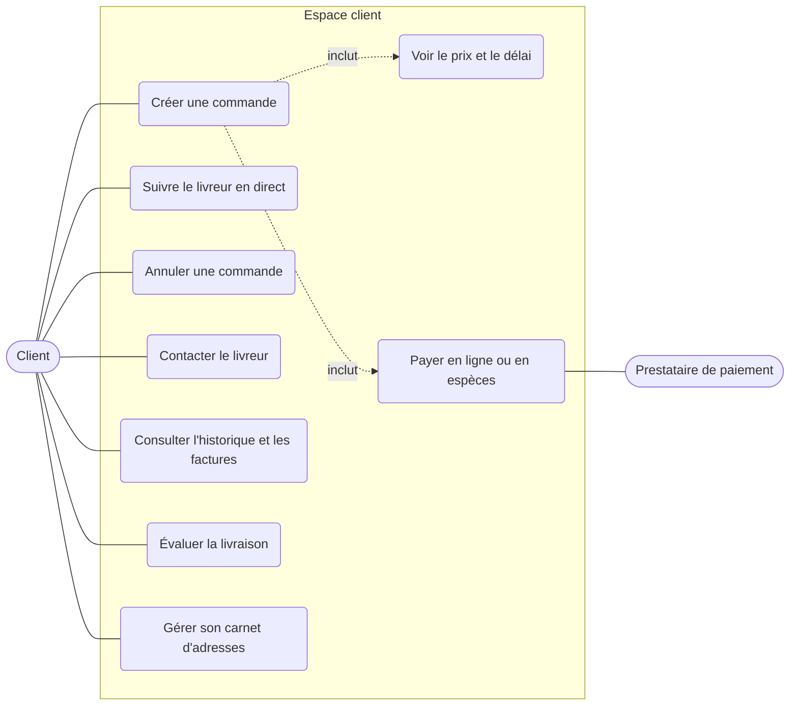
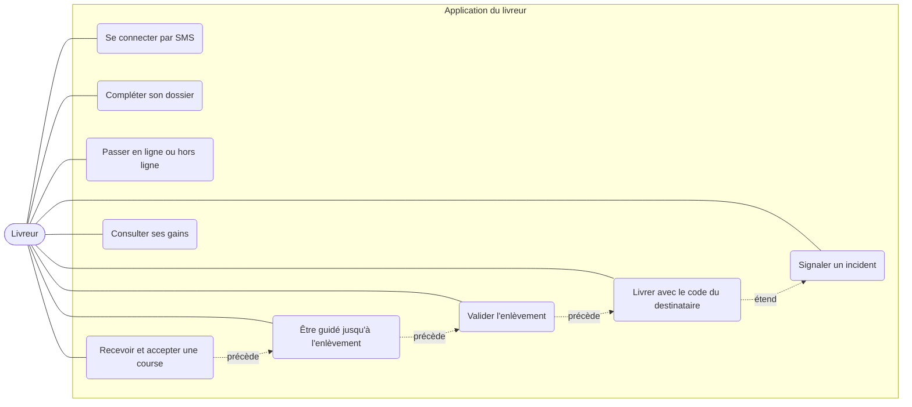
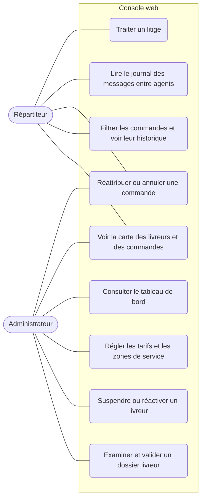
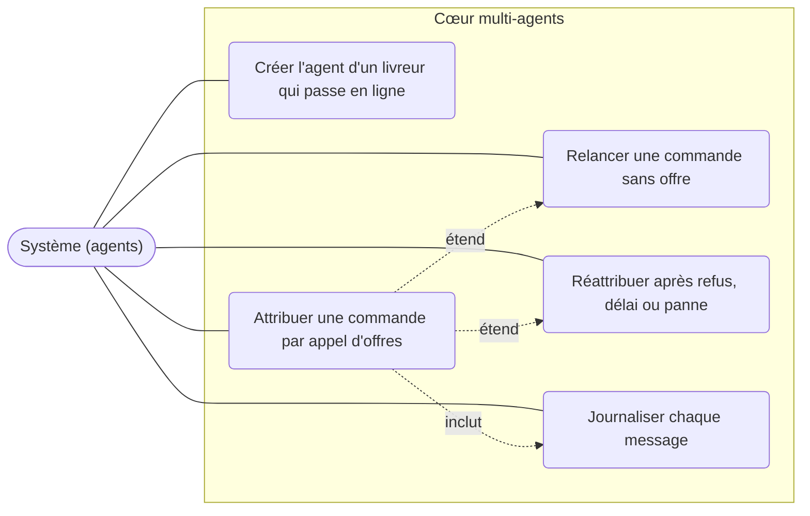

# 1. Cas d'utilisation

Dossier de conception, lot 1. Les identifiants `F-xx` renvoient aux exigences du cahier des charges v3
(`Cahier_des_charges_Livraison_SMA_v3.docx`, § 4), les lots à son planning (§ 8.2).

## 1.1 Acteurs

| Acteur | Qui est-ce | Interface |
|---|---|---|
| **Client** | Particulier ou professionnel qui fait livrer un colis à Abidjan | Application web (React) |
| **Livreur** | Coursier indépendant, à moto, en voiture ou à vélo | Application iOS (React Native / Expo) |
| **Répartiteur** | Personnel qui surveille les courses et corrige à la main | Console web (React) |
| **Administrateur** | Valide les livreurs, règle les tarifs et les zones | Console web (React) |
| **Prestataire de paiement** | Acteur externe : mobile money et carte bancaire | API du prestataire |
| **Système (agents)** | Les agents SPADE qui attribuent les courses sans intervention humaine | Aucune (XMPP) |

## 1.2 Diagrammes

Les diagrammes sont en Mermaid : ils s'affichent dans GitHub et dans VS Code (extension « Markdown
Preview Mermaid Support »). Mermaid n'a pas de diagramme de cas d'utilisation officiel : on utilise un
schéma de flux, les acteurs à gauche et les cas d'utilisation à droite.

### Client

### Livreur

### Répartiteur et administrateur

### Système (agents)

## 1.3 Description des cas d'utilisation

Priorité : **E** essentielle, **I** importante, **S** souhaitable (colonne « Priorité » du cahier).

| N° | Cas d'utilisation | Acteur | Exigences | Prio. | Lot |
|---|---|---|---|---|---|
| UC-01 | Se connecter par numéro de téléphone et code SMS | Client, Livreur | F-01, F-02 | E | 1 (fait) |
| UC-02 | Compléter son dossier : identité, véhicule, pièces justificatives | Livreur | F-03 | E | 1 (fait) |
| UC-03 | Examiner et valider un dossier livreur | Administrateur | F-03 | E | 1 (fait) |
| UC-04 | Passer en ligne ou hors ligne, émettre sa position | Livreur | F-20 | E | 1 (prototype fait), 3 |
| UC-05 | Gérer son carnet d'adresses | Client | F-04 | I | 4 |
| UC-06 | Créer une commande (adresses, colis, destinataire) | Client | F-10, F-41, F-43 | E | 4 |
| UC-07 | Voir le prix et le délai avant de valider | Client | F-11, F-50, F-42 | E | 4 |
| UC-08 | Payer en ligne ou en espèces | Client, Prestataire | F-51, F-52 | E | 5 |
| UC-09 | Créer l'agent d'un livreur qui passe en ligne | Système | F-30 | E | 2 |
| UC-10 | Attribuer une commande par appel d'offres | Système | F-31, F-32, F-42 | E | 2 |
| UC-11 | Relancer une commande sans offre (rayon élargi) | Système | F-33 | E | 2 |
| UC-12 | Réattribuer après refus, délai dépassé ou panne | Système | F-34 | E | 2, 7 |
| UC-13 | Recevoir une proposition de course et l'accepter ou la décliner | Livreur | F-21 | E | 3 |
| UC-14 | Être guidé jusqu'à l'enlèvement puis à la livraison | Livreur | F-22, F-42 | E | 3 |
| UC-15 | Valider l'enlèvement et la remise (code à usage unique ou photo) | Livreur | F-23 | E | 3 |
| UC-16 | Signaler un incident | Livreur | F-24 | E | 3 |
| UC-17 | Suivre le livreur en direct, avec l'heure d'arrivée estimée | Client | F-12 | E | 4 |
| UC-18 | Annuler une commande | Client | F-13 | I | 4 |
| UC-19 | Contacter le livreur sans divulguer les numéros | Client | F-14 | I | 4 |
| UC-20 | Consulter l'historique, télécharger les factures, évaluer | Client | F-15, F-53 | I | 4, 5 |
| UC-21 | Voir la carte des livreurs et des commandes | Répartiteur, Administrateur | F-60 | E | 6 |
| UC-22 | Filtrer les commandes, voir leur historique complet | Répartiteur | F-61 | E | 6 |
| UC-23 | Réattribuer, annuler une commande, suspendre un livreur | Répartiteur, Administrateur | F-62 | E | 1 (suspension faite), 6 |
| UC-24 | Lire le journal des messages entre agents d'une commande | Répartiteur | F-63 | I | 6 |
| UC-25 | Consulter le tableau de bord | Administrateur | F-64 | I | 6 |
| UC-26 | Traiter un litige ou une réclamation | Répartiteur | F-65, F-55 | I | 6 |
| UC-27 | Régler les tarifs et les zones de service | Administrateur | F-50, F-43 | E | 4, 6 |
| UC-28 | Rémunérer le livreur, calculer la commission, relever les reversements | Système, Administrateur | F-54 | I | 5 |
| UC-29 | Livraison programmée, option « urgent » | Client | F-16, F-35 | S, I | 4, 7 |
| UC-30 | Regrouper des commandes et optimiser une tournée | Système | F-44, F-45 | I, S | 7 |

## 1.4 Scénario détaillé : commander et être livré

**Acteurs** : Client, Livreur, Système (agents), Prestataire de paiement.
**Préconditions** : le client est connecté ; au moins un livreur validé est en ligne dans la zone de service.

| Étape | Action | Résultat |
|---|---|---|
| 1 | Le client saisit l'adresse d'enlèvement, l'adresse de livraison, la taille du colis et le contact du destinataire | La commande est à l'état `creee` |
| 2 | Le système calcule le prix et le délai, le client les voit | Le client peut valider |
| 3 | Le client paie (mobile money ou carte) ou choisit l'espèce à la livraison | La commande passe à `validee` |
| 4 | Le Dispatcher lance un appel d'offres aux livreurs proches ; chaque agent propose un coût ou refuse | État `recherche_livreur` |
| 5 | Le Dispatcher retient la meilleure offre ; le livreur retenu a 30 s pour confirmer | État `attribuee` |
| 6 | Le livreur est guidé jusqu'à l'enlèvement et valide la prise du colis | État `enlevee` |
| 7 | Le livreur est guidé jusqu'au destinataire ; le client suit sa position | État `en_livraison` |
| 8 | Le destinataire donne son code à usage unique, le livreur le saisit | État `livree` |
| 9 | Le système émet la facture, calcule la rémunération, le client peut noter | État `cloturee` |

**Scénarios alternatifs**

| Cas | Ce qui se passe | Voir |
|---|---|---|
| Aucun livreur ne propose | La commande reste en `recherche_livreur`, relancée avec un rayon plus large ; le répartiteur est alerté après plusieurs échecs | séquence S3 |
| Le livreur retenu ne confirme pas à temps | Il est écarté pour cette commande, un nouvel appel d'offres part | séquence S4 |
| Le client annule avant l'attribution | Annulation sans frais, la commande passe à `annulee` | états, § 2.1 |
| Le destinataire est absent ou l'adresse introuvable | Le livreur signale un incident, la commande passe à `echec_livraison` | états, § 2.1 |
| Deux commandes visent le même livreur en même temps | Une seule lui est attribuée à la fois | séquence S6 |
