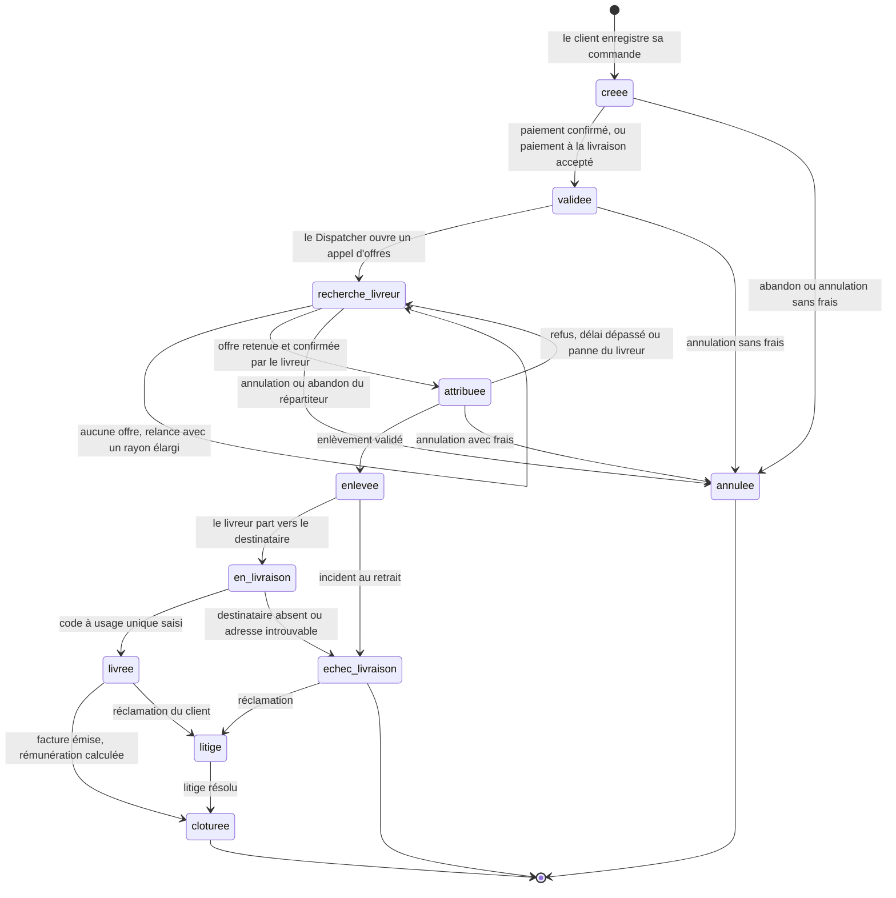
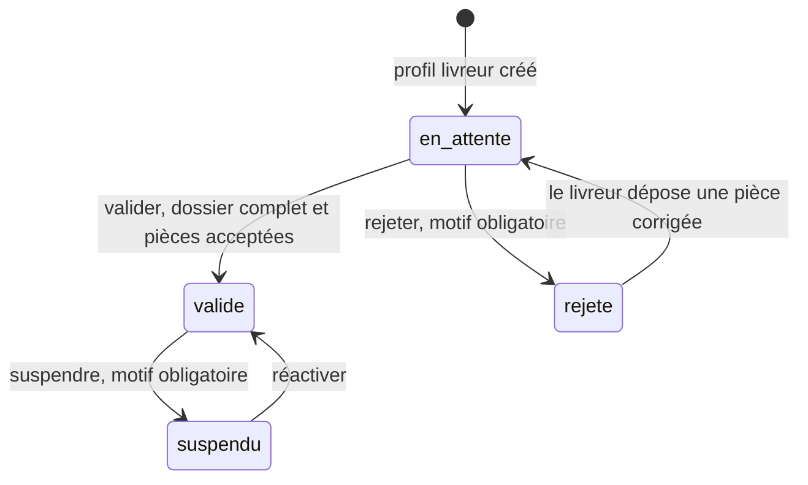
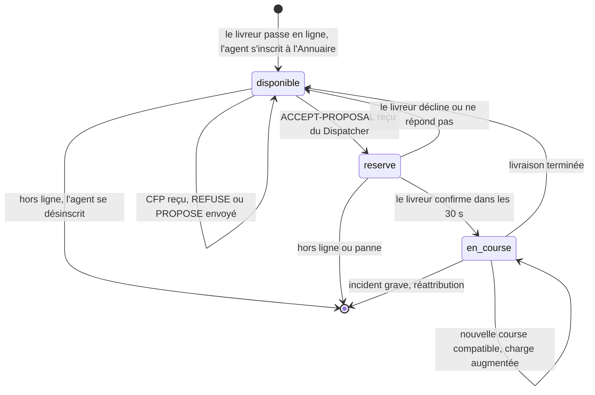
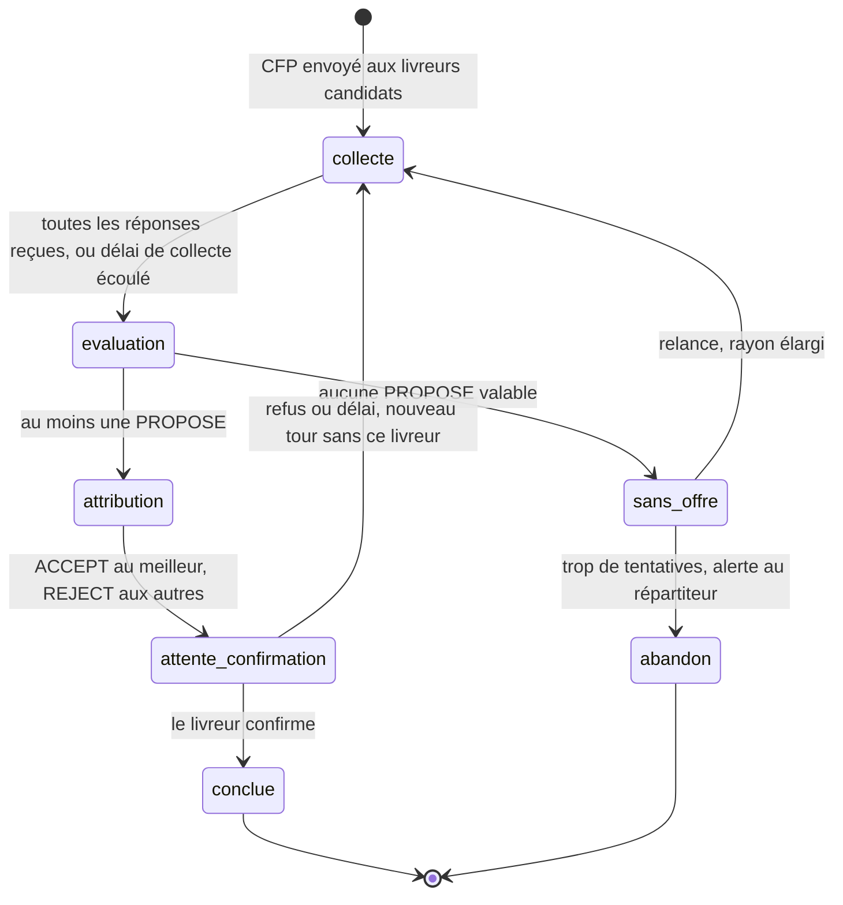
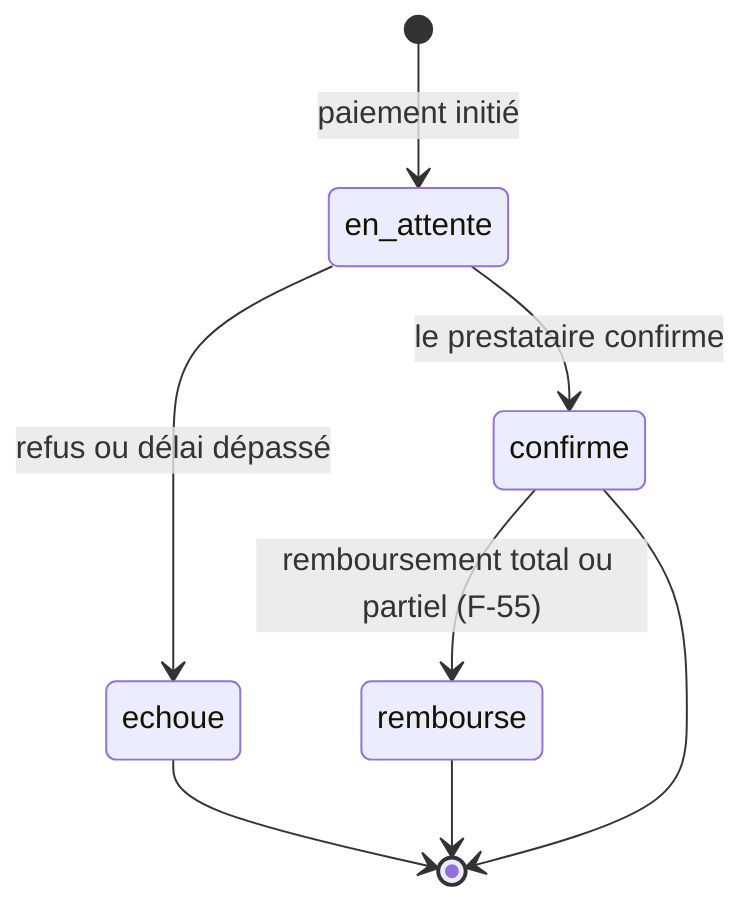

# 2. Diagrammes d'états

Les états de la commande, du livreur et du paiement sont ceux du code
(`src/livraison/persistance/enums.py`), pour que le dossier et le logiciel disent la même chose.
L'état de l'agent Livreur et celui d'une conversation d'appel d'offres sont propres au lot 2.

## 2.1 Commande (`EtatCommande`, cahier § 3.4)

Les états **finaux** sont `cloturee`, `annulee` et `echec_livraison` : une commande qui y arrive n'évolue
plus (NF-04, constante `ETATS_FINAUX`). `litige` n'est pas final. Une commande « attribuée, enlevée ou en
livraison » a toujours un livreur : c'est une contrainte de la base de données.

## 2.2 Dossier du livreur (`StatutValidation`, F-03)

Détail des règles : `docs/dossier-livreur.md`. Seul un livreur `valide` reçoit des courses.

## 2.3 Disponibilité d'un livreur et état de son agent (F-30, lot 2)

L'agent Livreur existe **uniquement** pendant que le livreur est en ligne.

`en_course` garde le livreur disponible aux nouvelles propositions tant que sa **charge** reste sous son
maximum (F-32, F-44). C'est pourquoi la formule du coût contient une pénalité proportionnelle à la charge.

## 2.4 Une conversation d'appel d'offres (Contract Net, F-31 à F-33)

Une conversation est identifiée par la commande et le **tour** (un tour = un appel d'offres, table `offre`).

Chaque offre reçoit un résultat (`ResultatOffre`) :

| Résultat | Signification |
|---|---|
| `proposee` | PROPOSE reçu, en attente de décision |
| `retenue` | ACCEPT-PROPOSAL envoyé (au plus une par commande et par tour, contrainte de la base) |
| `rejetee` | REJECT-PROPOSAL envoyé |
| `refusee` | REFUSE de l'agent (saturé, hors zone, colis trop lourd, GPS trop ancien) |
| `declinee` | le livreur a décliné ou n'a pas répondu à temps |
| `expiree` | aucune réponse de l'agent dans le délai de collecte |

## 2.5 Paiement (`EtatPaiement`, F-51 à F-55)

Un seul paiement `confirme` par commande (contrainte de la base).
