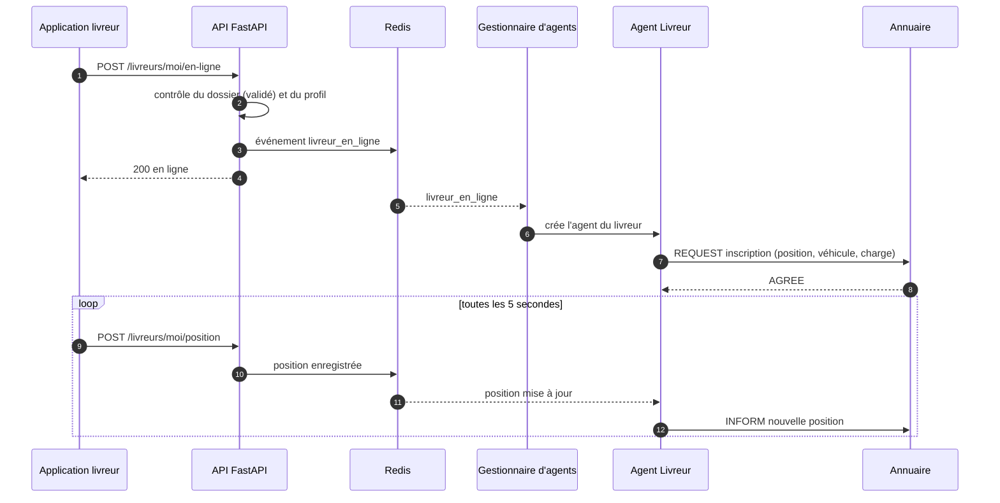
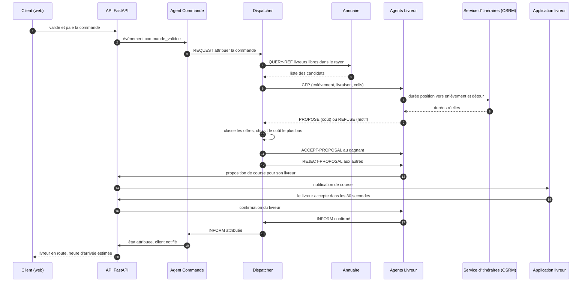
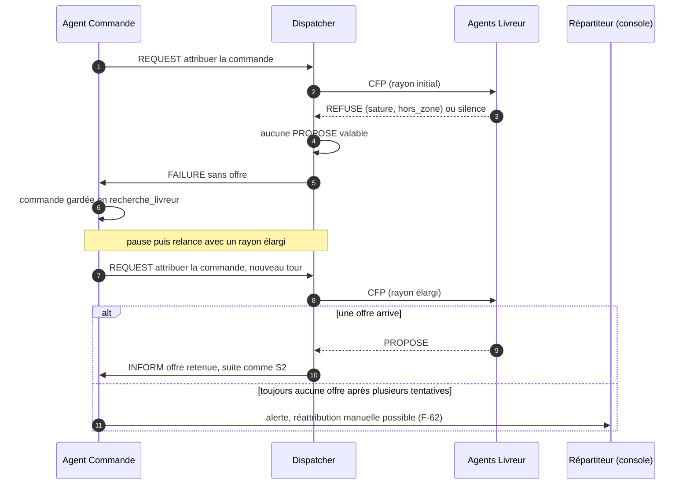
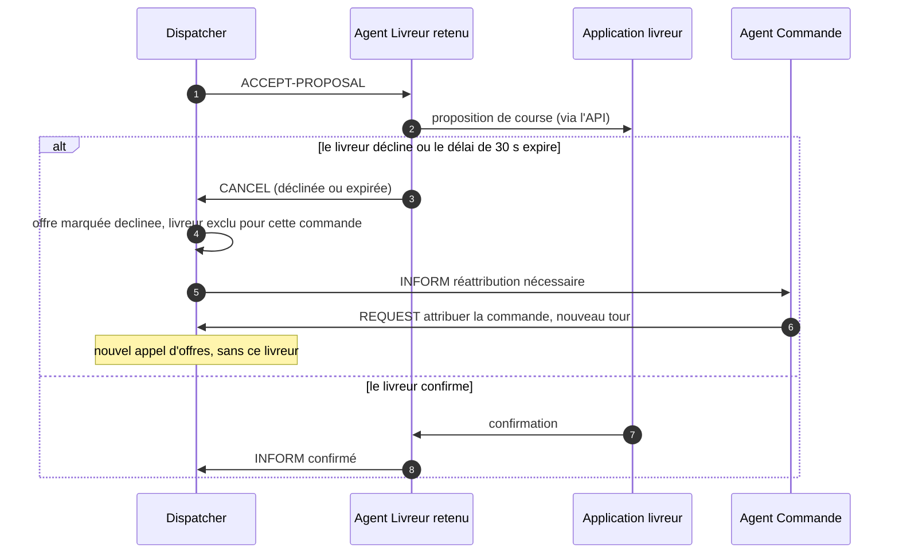
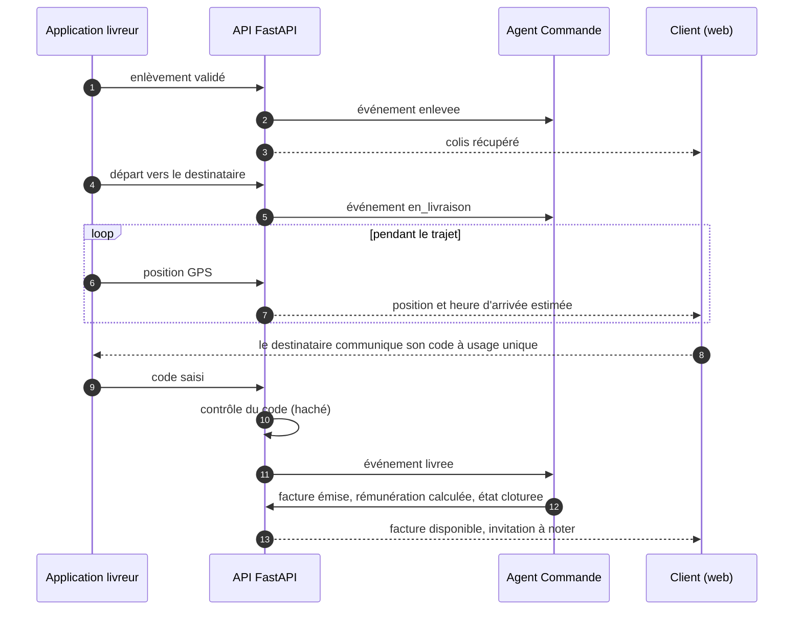
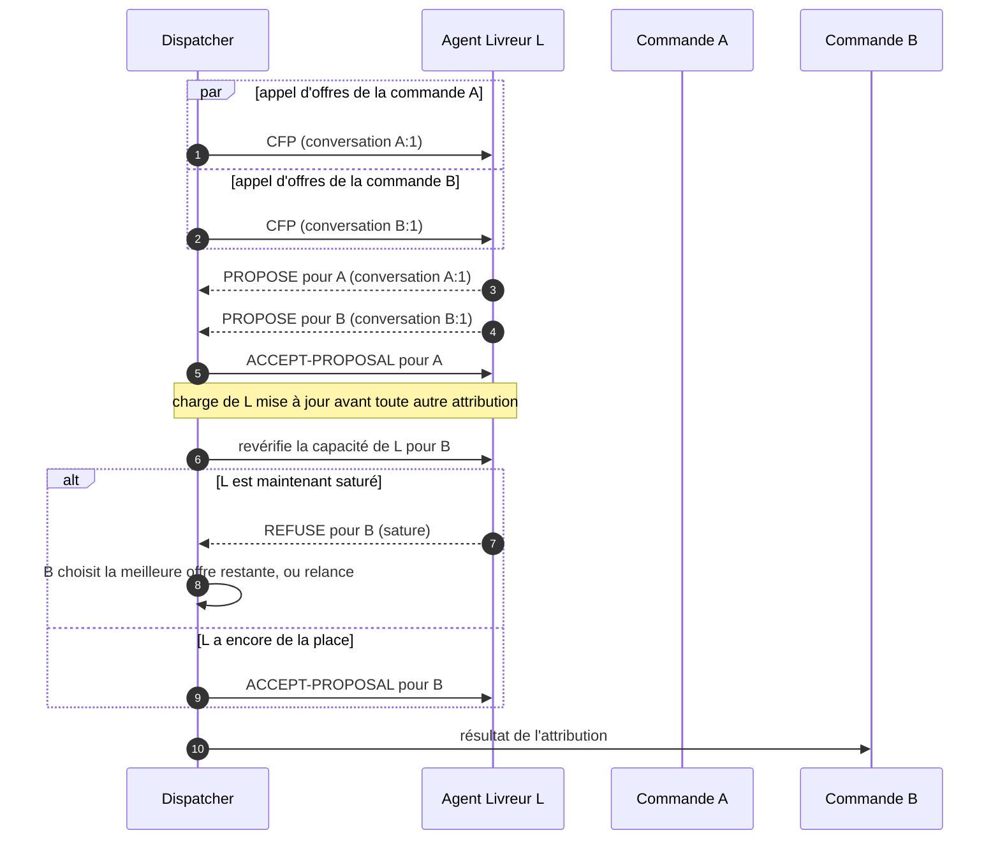

# 3. Protocole entre agents : séquences

Les agents sont des agents **SPADE** qui s'échangent des messages **FIPA-ACL** par XMPP. Les applications
(iOS, web) ne parlent **jamais** directement aux agents : l'API traduit leurs actions en événements,
transmis aux agents par Redis, et renvoie leurs décisions (décision D-02, `06-decisions.md`).

## 3.1 Agents et responsabilités

| Agent | Quand il existe | Rôle |
|---|---|---|
| **Annuaire** | en permanence | Tient la liste des livreurs disponibles (service « livreur ») avec leur position et leur charge |
| **Dispatcher** | en permanence | Choisit à qui attribuer une commande : lance l'appel d'offres, compare les offres, désigne le gagnant |
| **Livreur** | pendant que le livreur est en ligne | Représente un livreur : calcule son coût pour une course, accepte ou refuse en son nom |
| **Commande** | de la validation à l'état final | Suit une commande, déclenche l'attribution et les relances, journalise |

## 3.2 Messages (performatives FIPA-ACL)

L'identifiant de conversation (`conversation-id`) est `<commande_id>:<tour>`.

| Message | De | Vers | Contenu |
|---|---|---|---|
| `REQUEST` (inscription) | Livreur | Annuaire | service `livreur`, position, véhicule, capacité, charge |
| `INFORM` (mise à jour) | Livreur | Annuaire | nouvelle position ou nouvelle charge |
| `QUERY-REF` | Dispatcher | Annuaire | livreurs disponibles dans un rayon autour d'un point |
| `CFP` | Dispatcher | Livreurs candidats | enlèvement, livraison, taille et poids du colis, priorité, délai de réponse |
| `PROPOSE` | Livreur | Dispatcher | coût, durée jusqu'à l'enlèvement, détour, charge |
| `REFUSE` | Livreur | Dispatcher | motif : `sature`, `hors_zone`, `trop_lourd`, `gps_ancien`, `vehicule`, `hors_ligne` |
| `ACCEPT-PROPOSAL` | Dispatcher | Livreur retenu | commande à exécuter |
| `REJECT-PROPOSAL` | Dispatcher | Autres livreurs | aucune action |
| `INFORM` (confirmation) | Livreur | Dispatcher et Commande | le livreur humain a confirmé |
| `CANCEL` / `FAILURE` | Livreur | Dispatcher | le livreur a décliné, n'a pas répondu, ou est tombé en panne |

Le **coût** d'une offre (secondes) :
`durée(position du livreur → enlèvement) + durée du détour + pénalité × charge`, les durées venant de
l'itinéraire réel (OSRM, F-42). Le livreur au coût le plus bas gagne. Exemple chiffré, pénalité de 300 s
par course déjà portée :

| Livreur | Jusqu'à l'enlèvement | Détour | Charge | Coût |
|---|---|---|---|---|
| A | 420 s | 0 s | 0 | 420 s |
| B | 180 s | 240 s | 2 | 180 + 240 + 600 = 1 020 s |

A gagne malgré un trajet plus long jusqu'à l'enlèvement, car B est déjà chargé (la fonction réelle est dans
`src/livraison/modele/cout.py` : ce tableau doit rester cohérent avec elle).

## S1. Un livreur passe en ligne (F-30)

## S2. Attribution d'une commande, cas nominal (F-31)

## S3. Aucune offre : file d'attente et relance (F-33)

## S4. Le livreur ne confirme pas dans les 30 secondes (F-34)

## S5. Déroulement de la course jusqu'à la clôture (F-23)

## S6. Deux commandes visent le même livreur en même temps (F-32)

Les identifiants de conversation distincts évitent toute confusion entre les deux appels d'offres. La
garantie de non double attribution est aussi dans la base : une seule offre `retenue` par commande et par
tour, et la charge d'un livreur n'est mise à jour qu'à l'intérieur d'une transaction.
