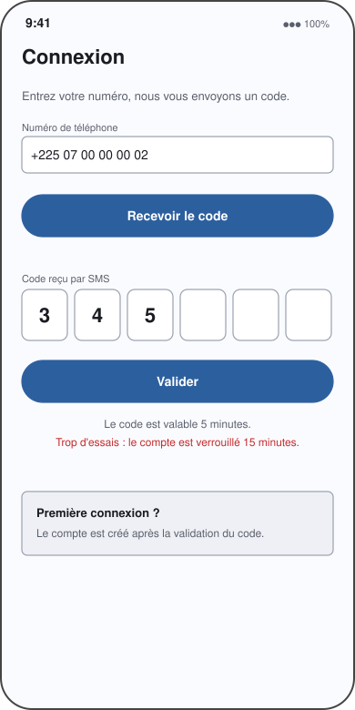
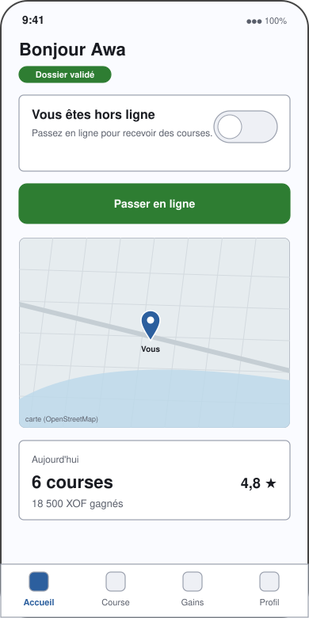
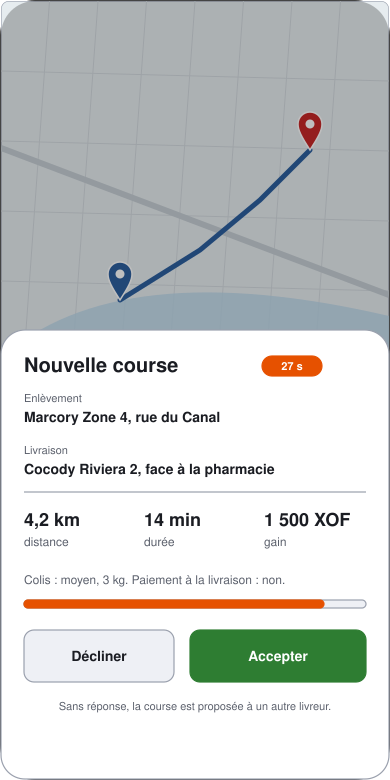
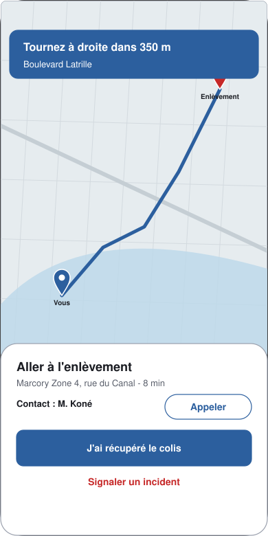
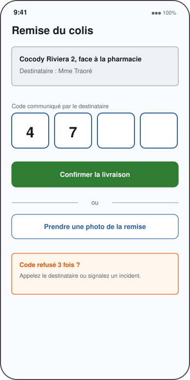
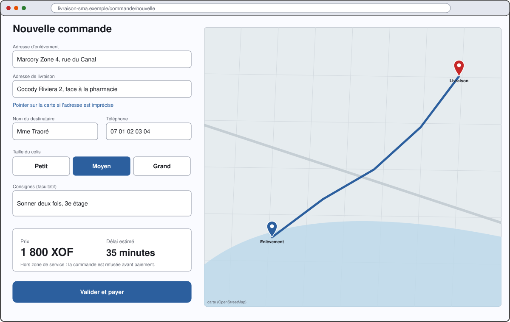
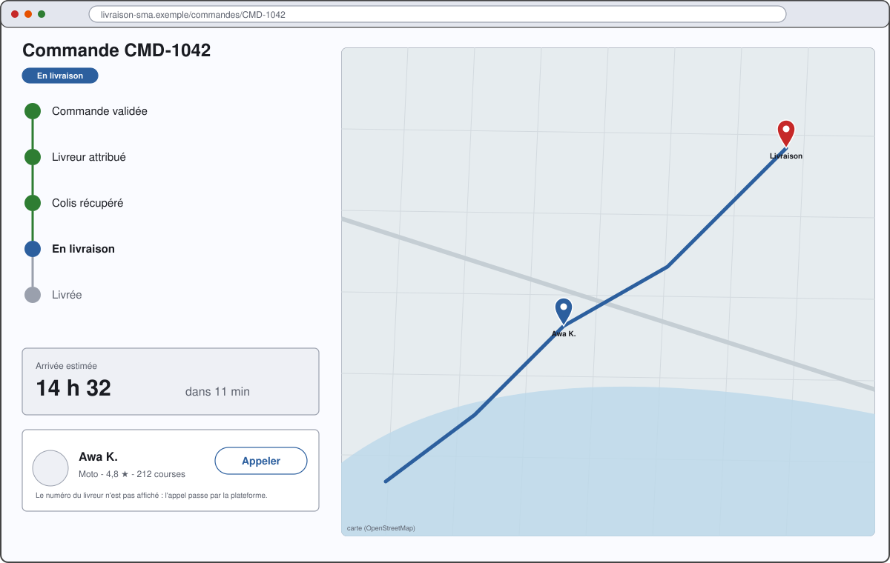
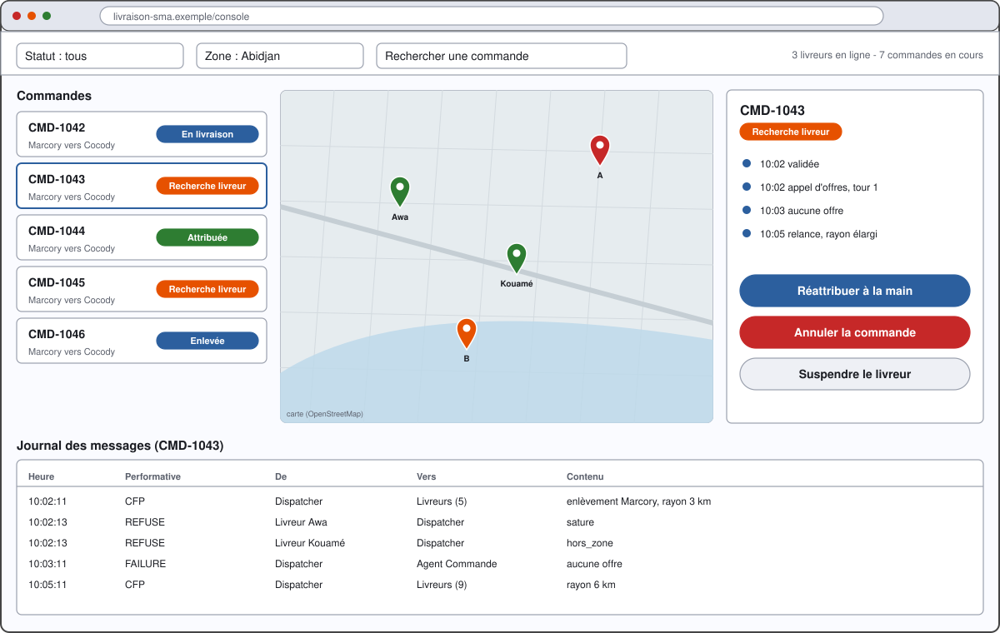
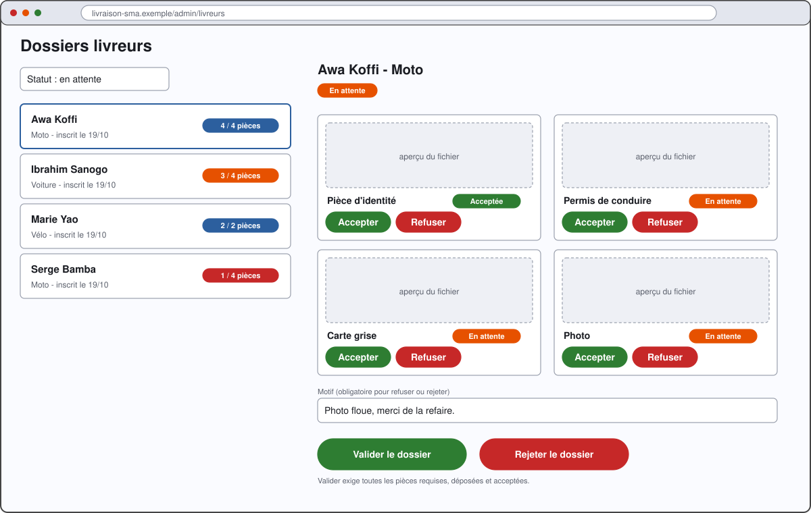

# 4. Maquettes des écrans

Neuf maquettes **fonctionnelles** (fil de fer) des écrans essentiels : elles fixent ce que chaque écran
montre et permet, pas son design final. Les fichiers sont dans `docs/conception/maquettes/` (format SVG,
visibles dans GitHub, VS Code et tout navigateur).

| N° | Écran | Interface | Exigences | Lot |
|---|---|---|---|---|
| M-01 | Connexion du livreur | iOS | F-01 | 3 |
| M-02 | Accueil du livreur | iOS | F-03, F-20 | 3 |
| M-03 | Proposition de course | iOS | F-21 | 3 |
| M-04 | Course en cours | iOS | F-22, F-23, F-24 | 3 |
| M-05 | Remise du colis | iOS | F-23 | 3 |
| M-06 | Nouvelle commande | Web client | F-10, F-11, F-41, F-43 | 4 |
| M-07 | Suivi de la livraison | Web client | F-12, F-14 | 4 |
| M-08 | Console du répartiteur | Web console | F-60 à F-63 | 6 |
| M-09 | Examen des dossiers livreurs | Web console | F-03 | 6 |

Les écrans de connexion et d'accueil du livreur (M-01, M-02) ont déjà un équivalent fonctionnel dans le
prototype `mobile/gps-ios/`, sans carte ni dossier. Le serveur du dossier livreur (M-09) est livré : il
manque l'écran.

## M-01. Connexion du livreur

Le numéro est contrôlé par le serveur (format international). Le code SMS a 6 chiffres, vaut 5 minutes, et
le compte est verrouillé après trop d'essais (NF-05). Le compte est créé à la première validation.

## M-02. Accueil du livreur

Le statut du dossier est toujours visible. Le bouton **Passer en ligne** déclenche l'envoi de la position
toutes les 5 secondes et la création de l'agent Livreur (séquence S1). Tant que le dossier n'est pas
validé, le bouton est désactivé et explique pourquoi.

## M-03. Proposition de course

Le livreur a **30 secondes** pour répondre. Sans réponse, la course repart vers un autre livreur
(séquence S4). Le gain affiché est celui du livreur, pas le prix payé par le client.

## M-04. Course en cours

Le bandeau donne la prochaine manœuvre. **J'ai récupéré le colis** fait passer la commande à `enlevee`.
L'incident ouvre une liste fermée : destinataire absent, adresse introuvable, panne, accident (F-24). Le
numéro du client reste masqué : l'appel passe par la plateforme (F-14).

## M-05. Remise du colis

Le destinataire communique un code à usage unique, que le serveur compare à sa version hachée. Après trois
refus, l'écran propose d'appeler le destinataire ou de signaler un incident. La photo de la remise est
l'autre preuve acceptée (F-23).

## M-06. Nouvelle commande

Adresses saisies ou pointées sur la carte (F-41). Le prix et le délai s'affichent **avant** la validation
(F-11). Une adresse hors zone de service est refusée avant tout paiement (F-43).

## M-07. Suivi de la livraison

Les étapes sont celles des états de la commande (`02-diagrammes-etats.md`, § 2.1). L'heure d'arrivée est
recalculée à partir de la position du livreur, et la position affichée a moins de 10 secondes de retard
(NF-01).

## M-08. Console du répartiteur

C'est la version React de l'actuelle carte Flet (`console_suivi.py`), complétée par la liste des commandes,
le détail avec historique et le **journal des messages entre agents** (équivalent du Sniffer JADE, F-63).
Les boutons de correction manuelle sont ceux de F-62.

## M-09. Examen des dossiers livreurs

Chaque pièce est acceptée ou refusée avec un motif ; le dossier n'est validable que lorsque toutes les
pièces requises sont acceptées. Les routes correspondantes existent déjà (`/admin/livreurs`,
`/admin/pieces/{id}/decision`, voir `docs/dossier-livreur.md`).
