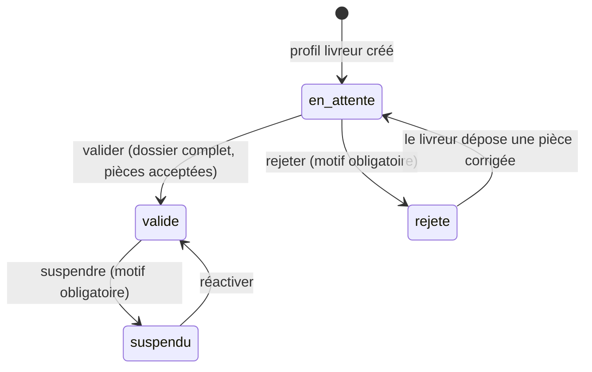

# Dossier livreur (F-03) : guide d'installation et d'utilisation

Un livreur remplit son dossier (identité, véhicule, pièces justificatives) ; l'administrateur
l'examine puis le valide avant toute course.

Tous les chemins de ce guide partent de la **racine du dépôt**, le dossier `livraison-sma/`
(celui qui contient `alembic.ini` et `docker-compose.yml`).

## 1. Fichiers livrés et où les placer

Légende : **NOUVEAU** = le fichier n'existe pas encore chez toi, on le crée ;
**REMPLACE** = le fichier existe déjà, on écrase l'ancien par la nouvelle version.

```
livraison-sma/
├── migrations/
│   └── versions/
│       └── 0003_dossier_livreur.py        NOUVEAU
├── src/
│   └── livraison/
│       ├── config.py                      REMPLACE
│       ├── api/
│       │   ├── main.py                    REMPLACE
│       │   ├── routes_dossier.py          NOUVEAU
│       │   ├── routes_admin.py            NOUVEAU
│       │   └── schemas_dossier.py         NOUVEAU
│       ├── persistance/
│       │   └── modeles.py                 REMPLACE
│       └── services/
│           └── dossier.py                 NOUVEAU
├── tests/
│   ├── conftest.py                        REMPLACE
│   └── test_dossier_livreur.py            NOUVEAU
└── docs/
    ├── dossier-livreur.md                 NOUVEAU (ce fichier)
    └── modele-donnees.md                  REMPLACE
```

| Fichier (chemin complet depuis la racine) | Action | Rôle |
|---|---|---|
| `migrations/versions/0003_dossier_livreur.py` | NOUVEAU | Migration Alembic : colonnes d'examen des pièces, unicité d'une pièce par type, motif obligatoire en cas de refus, motif de rejet du dossier |
| `src/livraison/services/dossier.py` | NOUVEAU | Logique métier : dépôt des pièces, contrôle des fichiers, validation, rejet, suspension, réactivation |
| `src/livraison/api/routes_dossier.py` | NOUVEAU | Routes du **livreur** : `/livreurs/moi/dossier` et `/livreurs/moi/pieces/{type}` |
| `src/livraison/api/routes_admin.py` | NOUVEAU | Routes de l'**administrateur** : `/admin/...` |
| `src/livraison/api/schemas_dossier.py` | NOUVEAU | Formats des requêtes et des réponses de ces routes |
| `src/livraison/api/main.py` | REMPLACE | Branche les deux nouveaux routeurs |
| `src/livraison/persistance/modeles.py` | REMPLACE | Nouvelles colonnes de `Livreur` et de `DocumentLivreur` |
| `src/livraison/config.py` | REMPLACE | Deux nouveaux paramètres (stockage des pièces, taille maximale) |
| `tests/test_dossier_livreur.py` | NOUVEAU | 37 tests (service, base de données, API) |
| `tests/conftest.py` | REMPLACE | Vérifie que la migration 0003 est appliquée ; neutralise `LIVREUR_VALIDATION_REQUISE` pendant les tests |
| `docs/modele-donnees.md` | REMPLACE | Schéma mis à jour (colonnes de `document_livreur`, choix de conception) |

**Attention aux deux `main.py`** : celui à remplacer est `src/livraison/api/main.py` (le serveur).
Ne touche pas à `mobile/livreur/src/main.py` (l'app Flet du livreur).

### Si tu as modifié ces fichiers depuis ton dernier envoi

Pour `modeles.py`, `config.py`, `main.py` et `conftest.py`, ne remplace pas à l'aveugle : applique plutôt
ces changements à la main dans ta version.

| Fichier | Changement à reporter |
|---|---|
| `src/livraison/persistance/modeles.py` | Classe `Livreur` : ajouter `motif_rejet: Mapped[str \| None] = mapped_column(String(300))` après `valide_le`. Classe `DocumentLivreur` : ajouter `__table_args__` (contrainte `uq_document_livreur_un_par_type` sur `livreur_id` + `type`, et CHECK `motif_si_refuse`), puis les colonnes `type_mime`, `taille_octets`, `examine_par_id`, `examine_le` |
| `src/livraison/config.py` | Ajouter `stockage_pieces_dir: str = "stockage/pieces"` et `piece_taille_max_octets: int = 5 * 1024 * 1024` |
| `src/livraison/api/main.py` | Importer `routeur_admin` (depuis `routes_admin`) et `routeur_dossier` (depuis `routes_dossier`), puis `app.include_router(routeur_dossier)` et `app.include_router(routeur_admin)` |
| `tests/conftest.py` | Dans `configuration_de_test` : `monkeypatch.setattr(parametres, "livreur_validation_requise", False)`. Dans `session` : deux `SELECT` de contrôle en plus (`motif_rejet, valide_le FROM livreur` et `type_mime, examine_le FROM document_livreur`) |

## 2. Mise en route, dans l'ordre

Terminal ouvert **à la racine du dépôt**, venv activé, Docker démarré.

**Étape 1.** Copier les fichiers du tableau ci-dessus à leur place.

**Étape 2.** Installer la dépendance qui permet à FastAPI de recevoir des fichiers (sans elle, le serveur ne démarre plus) :

```powershell
pip install python-multipart
```

Puis ajouter la ligne `python-multipart` dans `requirements.txt` (à la racine).

**Étape 3.** Ignorer les pièces dans Git : ajouter la ligne `stockage/` dans `.gitignore` (à la racine).
Les pièces d'identité des livreurs ne doivent jamais être versionnées.

**Étape 4.** Appliquer la migration et la vérifier :

```powershell
alembic upgrade head
alembic check             # doit répondre « No new upgrade operations detected »
```

**Étape 5.** Lancer les tests. Ils tournent sur une base à part (`livraison_test`) : prépare-la d'abord,
voir `docs/tests.md` (une seule fois, puis après chaque nouvelle migration) :

```powershell
python scripts/preparer_base_test.py
pytest tests/test_dossier_livreur.py     # 37 tests du dossier livreur
pytest                                    # tous les tests : les 98 d'avant doivent toujours passer
```

Si la base de test n'est pas prête, les tests qui touchent la base sont **ignorés** (« skipped »), pas
en échec : le message demande alors de lancer `python scripts/preparer_base_test.py`.

**Étape 6.** Redémarrer le serveur :

```powershell
uvicorn livraison.api.main:app --host 0.0.0.0 --reload --reload-dir src
```

La page `http://127.0.0.1:8000/docs` doit maintenant montrer deux nouvelles sections :
« Dossier livreur » et « Administration des livreurs ».

### Réglage facultatif dans `.env` (à la racine)

```
LIVREUR_VALIDATION_REQUISE=true
```

- `false` (valeur par défaut) : un livreur peut passer en ligne sans dossier validé. C'est ce qu'il faut
  tant que tu testes les prototypes GPS (iPhone, Flet) avec des comptes jamais validés.
- `true` : un livreur non validé reçoit `403 Votre dossier doit être validé avant de passer en ligne.`

Les pièces sont rangées dans `stockage/pieces/` (dossier créé automatiquement). Pour les mettre
ailleurs : `STOCKAGE_PIECES_DIR=D:\donnees\pieces` dans `.env`.

## 3. Compte administrateur

```powershell
python scripts/creer_personnel.py --telephone 0102030405 --role administrateur --nom Admin
```

Le numéro doit être différent de celui du répartiteur et de ceux des livreurs. Ce script n'a pas été
revu pour cette livraison : s'il refuse `--role administrateur`, envoie-moi `scripts/creer_personnel.py`.

## 4. Parcours d'un dossier



| Étape | Qui | Route |
|---|---|---|
| 1. Identité | livreur | `PATCH /auth/moi` (nom, prénom) |
| 2. Véhicule | livreur | `PUT /livreurs/moi/profil` (déjà en place) |
| 3. Pièces | livreur | `PUT /livreurs/moi/pieces/{type}` avec le fichier |
| 4. Suivi | livreur | `GET /livreurs/moi/dossier` : statut, décisions, pièces manquantes, motif de rejet |
| 5. Examen | administrateur | `GET /admin/livreurs?statut=en_attente`, `GET /admin/pieces/{id}/fichier`, `POST /admin/pieces/{id}/decision` |
| 6. Décision | administrateur | `POST /admin/livreurs/{id}/valider` ou `/rejeter` |
| 7. Ensuite | administrateur | `POST /admin/livreurs/{id}/suspendre` (le livreur passe hors ligne et quitte la carte), `/reactiver` |

## 5. Pièces exigées

| Véhicule | Types de pièces (valeur à mettre dans l'URL) |
|---|---|
| moto, voiture | `piece_identite`, `photo`, `permis`, `carte_grise` |
| vélo | `piece_identite`, `photo` |

Pour valider : nom et prénom renseignés, toutes les pièces exigées déposées **et acceptées**. Sinon la
réponse est `409` avec la liste de ce qui manque.

## 6. Règles sur les fichiers

- JPEG, PNG ou PDF (JPEG ou PNG pour la photo), **5 Mo au maximum**.
- Le format est détecté sur le **contenu** du fichier, jamais sur son extension ni sur l'en-tête envoyé
  par le client. Réponses : `413` trop gros, `415` format refusé, `422` fichier vide.
- Une seule pièce par type : déposer à nouveau remplace la précédente (et supprime l'ancien fichier),
  tant qu'elle n'est pas acceptée. Une pièce acceptée ou un dossier validé ne se modifie plus
  (`409`) : l'administrateur suspend d'abord le livreur pour rouvrir le dossier.
- Les fichiers ne sont jamais servis publiquement : seul un administrateur peut les lire, sans mise en
  cache. Une pièce inexistante ou interdite répond toujours `404`.

## 7. Essayer à la main avec Swagger (`http://127.0.0.1:8000/docs`)

**Côté livreur**, avec un numéro neuf (par exemple `07 00 00 00 05`) :

1. `POST /auth/code` avec le numéro, puis lire le code dans la console d'uvicorn (`[SMS SIMULÉ]`).
2. `POST /auth/verifier` avec `"role": "livreur"` : copier `access_token`, cliquer **Authorize**, le coller.
3. `PUT /livreurs/moi/profil` avec `{"type_vehicule": "moto", "capacite_kg": 25}`.
4. `PATCH /auth/moi` avec `{"nom": "Koffi", "prenom": "Awa"}`.
5. `PUT /livreurs/moi/pieces/piece_identite` : choisir une photo JPEG ou PNG ; recommencer pour
   `photo`, `permis` et `carte_grise`.
6. `GET /livreurs/moi/dossier` : `complet` doit valoir `true`.

**Côté administrateur** (cliquer **Authorize** avec le jeton de l'administrateur, voir ci-dessous) :

1. `POST /auth/connexion` avec le numéro et le mot de passe de l'administrateur : copier `access_token`,
   puis **Authorize** (remplace le jeton du livreur).
2. `GET /admin/livreurs?statut=en_attente` : copier l'`id` de chaque pièce.
3. `GET /admin/pieces/{id}/fichier` : le fichier s'affiche.
4. `POST /admin/pieces/{id}/decision` avec `{"accepte": true}`, pour chaque pièce.
5. `POST /admin/livreurs/{livreur_id}/valider` : `statut_validation` passe à `valide`.

Pour refuser une pièce : `{"accepte": false, "motif": "Photo floue."}`. Le motif est obligatoire et le
livreur le verra dans `GET /livreurs/moi/dossier`.

## 8. Traçabilité et confidentialité

Chaque décision (pièce acceptée ou refusée, dossier validé ou rejeté, livreur suspendu ou réactivé)
ajoute une ligne au journal `evenement` (type `action_manuelle`, auteur `utilisateur:<id>`). Le détail
ne contient que des identifiants, jamais de nom, de téléphone ni de motif. Le motif lisible par le livreur
est stocké dans `livreur.motif_rejet` ou `document_livreur.motif_refus`.

## 9. Pour le lot 2

Le Dispatcher ne doit proposer des courses qu'aux livreurs pour lesquels
`dossier.peut_recevoir_des_courses(livreur)` (dans `src/livraison/services/dossier.py`) est vrai.

## 10. Limites connues

- Pas d'écran pour l'instant : l'interface React (lot 6) et l'écran React Native (lot 3) viendront plus
  tard. Les photos HEIC brutes de l'iPhone sont refusées : l'application mobile devra convertir en JPEG.
- Pas d'expiration des pièces (permis périmé) ni de notification quand le dossier est décidé : le livreur
  consulte `GET /livreurs/moi/dossier`.
- Les fichiers sont sur le disque du serveur : prévoir une sauvegarde, et en production un stockage chiffré.
- Si la transaction échoue juste après le remplacement d'une pièce, l'ancien fichier est déjà supprimé :
  le livreur voit « Fichier introuvable » et redépose la pièce.
