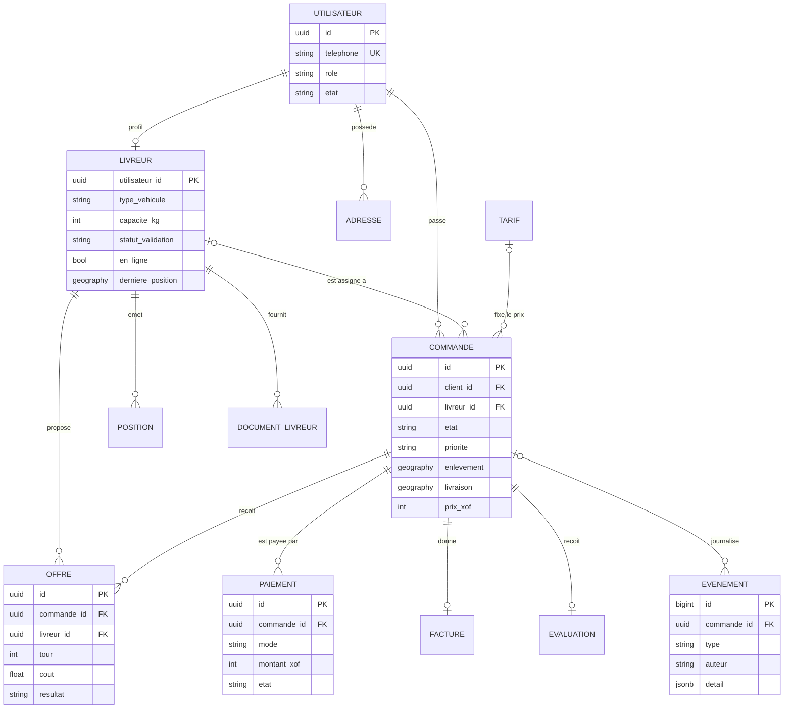

# Modèle de données — Livraison SMA

Lot 1 (conception et socle). Base PostgreSQL 16 + PostGIS 3.4, modèles SQLAlchemy dans
`src/livraison/persistance/`, schéma créé par la migration `migrations/versions/0001_schema_initial.py`.

## Schéma



Hors schéma : `CODE_VERIFICATION` (codes SMS, lié au téléphone et non à un compte, car il sert
avant la création du compte) et `ZONE_SERVICE` (polygones des zones de service). `POSITION`,
`DOCUMENT_LIVREUR`, `ADRESSE`, `FACTURE` et `EVALUATION` apparaissent avec leurs liens mais sans leurs colonnes.

## Correspondance avec le cahier des charges

| Table | Rôle | Exigences |
|---|---|---|
| `utilisateur`, `code_verification` | comptes, rôles, codes SMS | F-01, F-02, NF-05 |
| `livreur`, `document_livreur` | profil, véhicule, validation du dossier | F-03, F-20 |
| `position` | historique GPS (la dernière position est aussi dans Redis) | F-20, NF-01, NF-07 |
| `adresse` | carnet d'adresses du client | F-04 |
| `zone_service` | zones de service, refus hors zone | F-43 |
| `tarif` | part fixe, prix au km, suppléments | F-50 |
| `commande` | cycle de vie, trajet, colis, preuve de livraison | F-10 à F-16, § 3.4 |
| `offre` | réponses au Contract Net (un tour = un appel d'offres) | F-31, F-32, F-33 |
| `paiement`, `facture` | encaissement, remboursement partiel, reçu numéroté | F-51 à F-55 |
| `evaluation` | note du livreur | F-15 |
| `evenement` | journal d'une commande et des messages entre agents | F-61, F-63, NF-09 |

## Choix de conception

- **Montants en entiers (XOF).** Le franc CFA n'a pas de centimes : pas de `float`, pas d'erreur d'arrondi.
- **Clés UUID** pour tout ce que l'API expose (un client ne peut pas deviner l'identifiant d'une commande
  d'un autre) ; `BIGINT` auto-incrémenté pour `position` et `evenement`, très volumineuses.
- **Positions en `geography(Point, 4326)`.** Les distances sont en mètres, avec `ST_DWithin` pour
  présélectionner les livreurs autour d'un point d'enlèvement. Attention : l'ordre est **longitude, latitude**.
- **Énumérations en texte + contrainte CHECK**, pas en type ENUM PostgreSQL : ajouter un état ou un mode ne
  demande qu'une petite migration.
- **Règles d'intégrité dans la base**, pas seulement dans le code Python (les agents et l'API peuvent avoir des bugs) :
  téléphone au format international, prix positif, une commande « attribuée / enlevée / en livraison » a toujours
  un livreur (NF-04), une seule offre retenue par commande et par tour (F-32), un seul paiement confirmé par
  commande, un seul tarif actif.
- **Journal `evenement` en ajout seul.** Un déclencheur PostgreSQL interdit `UPDATE` et `DELETE` (NF-06, NF-09).
  Pour rester compatible avec le droit à l'effacement (NF-07), il ne contient que des identifiants, jamais de nom
  ni de téléphone.
- **Codes SMS et codes de livraison hachés**, jamais stockés en clair (NF-05).
- **Incidents (F-24)** : enregistrés comme événements de type `incident`, sans table à part pour le moment.

## Ce qui n'est pas encore modélisé

À ajouter dans les lots concernés, par une nouvelle migration :

- lot 5 : reversements aux livreurs, commission de la plateforme, sommes en espèces détenues par livreur
  (F-52, F-54), codes de réduction et comptes professionnels (F-56) ;
- lot 6 : litiges et réclamations (F-65) ;
- lot 7 : purge ou partitionnement de `position` ; regroupement de commandes et tournées (F-44).

## Utilisation

Depuis la racine du projet, environnement activé et Docker démarré :

```powershell
alembic upgrade head      # crée ou met à jour les tables
alembic check             # doit répondre « No new upgrade operations detected »
pytest                    # les tests de base s'exécutent si la base est migrée
```

Modifier un modèle, puis générer la migration et **relire le fichier produit avant de l'appliquer** :

```powershell
alembic revision --autogenerate -m "description courte"
alembic upgrade head
```

Pour repartir d'une base vide : `alembic downgrade base`, puis `alembic upgrade head`.